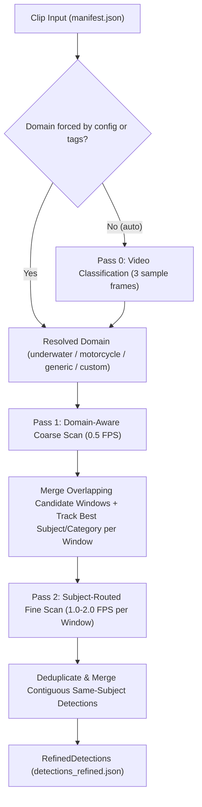

# Architecture Plan: [Issue #35] Add 3-stage domain-aware video classification and subject-routed highlight detection

- **Issue**: [#35](https://github.com/tiwu/dive-clip-tui/issues/35)
- **Status**: Completed
- **Author**: Autonomous Agent / Contributor
- **Date**: 2026-11-01
- **Target Branch**: `feature/issue-35-domain-aware-video-classification`

---

## 1. Problem Statement & Motivation

Currently, `dive-clip-tui` hardcodes underwater-specific Vision Language Model (VLM) prompts in `utils/prompt_templates.py` and `scripts/02_scan_footage.py`, always falling back to `BROAD_MARINE_TEMPLATE` whenever a clip has no DaVinci Resolve keywords. Although `README.md` states that the pipeline supports both dive and motorcycle footage, non-dive clips (such as motorcycle rides or general action camera clips) are evaluated with marine-life prompts.

To make `dive-clip-tui` a broadly applicable local video classifier and highlight detector while maintaining high subject precision in Pass 2:
1. We need a lightweight **Pass 0 (Video Domain Classification)** stage that samples a few frames per video to classify its domain (`underwater`, `motorcycle`, `generic`, or a custom domain defined in `config.yaml`).
2. **Pass 1 (Domain-Aware Coarse Scan)** should use a domain-level screening prompt that knows what unusable camera orientation looks like for that domain (e.g., dangling on a lanyard underwater vs. pointed at a fuel tank/ground on a motorcycle) and tags candidate frames with both a `subject` and a `category`.
3. **Pass 2 (Subject-Routed Fine Scan)** should dynamically route each merged candidate window to the most relevant specialized fine prompt template (`pelagics`, `macro`, `diver`, `moto_riding`, `moto_scenic`, `moto_group`, `generic_highlight`, or custom templates from `config.yaml`) based on the subjects detected during Pass 1.

---

## 2. Requirements & Acceptance Criteria

- [x] **Pass 0 (Clip Domain Classification)**:
  - Samples up to `classify_frames_count` (default: 3, e.g., at ~20%, 50%, 80% of extracted coarse frames, avoiding an extra FFmpeg pass) to classify the clip domain (`underwater`, `motorcycle`, `generic`, or custom domain).
  - Supports `scan_parameters.domain` (`"auto"` by default, or explicit domain override) and `scan_parameters.classify_clips` (`"auto"`, `"always"`, `"off"`).
  - When `classify_clips: "auto"` and a clip already has explicit domain/tags matching a template, Pass 0 inference is bypassed.
- [x] **Built-In Domains & Subject Templates (`utils/prompt_templates.py`)**:
  - **Underwater / Dive domain (`underwater`)**:
    - `pelagics` (Cyan): turtles, sharks, rays, mantas, whales, dolphins
    - `macro` (Yellow): nudibranchs, shrimp, corals, frogfish, seahorses, small creatures
    - `diver` (Green): diver action, buddy interaction, swim-throughs, wrecks
    - Fallback: `broad_marine` (Cyan)
  - **Motorcycle domain (`motorcycle`)**:
    - `moto_riding` (Orange): dynamic riding, cornering, lean angles, twisties, overtaking, track/sport action
    - `moto_scenic` (Blue): scenic mountain passes, coastal roads, landscapes, vistas, open road POV
    - `moto_group` (Green): group riding, fellow riders in formation, rider interaction
    - Fallback: `broad_motorcycle` (Orange)
  - **Generic Fallback domain (`generic`)**:
    - Fallback: `generic_highlight` (Magenta) for general action, sports, wildlife, or travel highlights.
- [x] **Custom Domains & Prompt Overrides via `config.yaml`**:
  - Users can define new domains or override/add subject templates under an optional `prompts:` section in `config.yaml`.
- [x] **Pass 1 → Pass 2 Per-Window Subject Routing**:
  - Pass 1 records detected `subject` and `category` per candidate frame.
  - Overlapping candidate windows are merged while tracking the highest-confidence subject/category within each merged window.
  - Pass 2 resolves and applies the matching `PromptTemplate` per candidate window and records `domain` and `template` on `RefinedDetection`.
- [x] **Checkpointing, Models & Statistics**:
  - `ClipManifest`, `Detection`, and `RefinedDetection` include optional `domain: str = ""` (backward-compatible).
  - `ClipScanCheckpoint` persists `detected_domain` and per-window subject/category routing hints across `--resume`.
  - `PipelineStats` tracks `Phase0Stats` (clips classified, frames analyzed, domain counts, elapsed time) while keeping `phase1` and `phase2` backward-compatible.
- [x] **Automated tests cover the acceptance criteria**
- [x] **All relevant documentation (`README.md`, `config.yaml`, `CHANGELOG.md`) has been updated**

---

## 3. Change Log and Release Impact

- **Change category**: Added
- **Proposed SemVer impact**: `semver:minor`
- **Draft changelog entry**:
  - Add a 3-stage domain-aware VLM scanning pipeline (Pass 0 clip domain classification, Pass 1 domain coarse screening, and Pass 2 subject-routed fine evaluation) with built-in underwater, motorcycle, and generic highlight templates plus custom prompt configuration in `config.yaml`.

---

## 4. Architecture & Implementation Design

### 4.1 Prompt Templates & Domain Registry (`utils/prompt_templates.py`)

- Add `domain: str = "underwater"` attribute to `PromptTemplate`.
- Introduce `DomainConfig` dataclass holding `name`, `keywords`, `description`, `coarse_prompt`, `fallback_template`, and `templates`.
- Add `VIDEO_CLASSIFICATION_PROMPT` and `build_classification_prompt(registry)` for Pass 0.
- Add `MOTORCYCLE_COARSE_PROMPT`, `MOTO_RIDING_TEMPLATE`, `MOTO_SCENIC_TEMPLATE`, `MOTO_GROUP_TEMPLATE`, `BROAD_MOTORCYCLE_TEMPLATE`, `GENERIC_COARSE_PROMPT`, and `GENERIC_HIGHLIGHT_TEMPLATE`.
- Add `load_custom_templates(config)` to merge optional `config["prompts"]` definitions with built-in domains/templates.
- Add `resolve_domain_from_keywords()` and `resolve_template_for_subject()` to match Pass 1 `category`/`subject` strings and clip `tags` to the most specific `PromptTemplate` within the active domain.
- Maintain backward compatibility for `ALL_TEMPLATES`, `BROAD_MARINE_TEMPLATE`, and `get_template_for_keywords()`.

### 4.2 Data Models, Checkpoints & Stats (`utils/models.py`, `utils/checkpoint.py`, `utils/stats.py`)

- `utils/models.py`: Add `domain: str = Field(default="")` to `ClipManifest`, `Detection`, and `RefinedDetection`.
- `utils/checkpoint.py`:
  - Add `category: str = ""` to `CoarseFrameResult`.
  - Add `detected_domain: str = ""` and `window_routing: dict[str, dict[str, str]] = Field(default_factory=dict)` to `ClipScanCheckpoint`.
- `utils/stats.py`:
  - Add `Phase0Stats` and attach `phase0: Phase0Stats = Field(default_factory=Phase0Stats)` to `PipelineStats`.
  - Include `phase0.frames_analyzed` in `fps_throughput` and display Phase 0 stats in `format_stats_table()` and `format_stats_log()` when clips are classified.

### 4.3 Scanner Pipeline (`scripts/02_scan_footage.py`)

- **Pass 0 (`classify_clip_domain`)**:
  - Reuses up to `classify_frames_count` evenly spaced frames from `coarse_frames` (e.g., 20%, 50%, 80%).
  - Calls `call_ollama(..., phase="classify")` and aggregates domain votes weighted by confidence.
  - Saves `detected_domain` in `ClipScanCheckpoint`.
- **Pass 1 (Coarse Scan)**:
  - Selects the coarse prompt from explicit tag template match or `domain_config.coarse_prompt`.
  - Tracks candidate windows along with each frame's `subject`, `category`, and `confidence`.
  - Merges overlapping candidate windows and selects the highest-confidence `(subject, category)` for each merged window.
- **Pass 2 (Fine Scan)**:
  - For each merged window, resolves the specialized `PromptTemplate` using `resolve_template_for_subject()`.
  - Evaluates fine frames with `template.fine_prompt` and emits `RefinedDetection` objects with `domain`, `template`, and `color`.

---

## 5. Test-Driven Development (TDD) Plan

1. **Red (Tests First)**:
   - Update `tests/test_prompt_templates.py` with tests for domain registry, motorcycle and generic templates, subject-to-template routing (`resolve_template_for_subject`), and custom YAML prompt loading (`load_custom_templates`).
   - Update `tests/test_scan_footage.py` with tests for Pass 0 classification voting, domain override / auto-skip behavior, Pass 1 → Pass 2 per-window subject prompt routing (e.g. motorcycle clip routing one window to `moto_riding` and another to `moto_scenic`), and checkpoint resume with `detected_domain`.
2. **Green (Implementation)**:
   - Implement domain/template registry in `utils/prompt_templates.py`.
   - Update models, checkpoint, and stats in `utils/models.py`, `utils/checkpoint.py`, and `utils/stats.py`.
   - Implement Pass 0, domain-aware Pass 1, and subject-routed Pass 2 in `scripts/02_scan_footage.py`.
   - Update `config.yaml` and `README.md`.
3. **Refactor & Quality**:
   - Run focused tests, then `uv run python -m pytest`.
   - Check lint and formatting on changed Python files with `uv run ruff check` and `uv run ruff format --check`.

---

## 6. Verification & Rollout Checklist

- [ ] Tests pass: `uv run python -m pytest`
- [ ] Changed Python files pass Ruff lint and formatting checks
- [ ] `CHANGELOG.md` updated under `[Unreleased]`
- [ ] PR has no conflicting SemVer labels (unlabeled defaults to minor)
- [ ] PR submitted with `Closes #35` and plan linked
