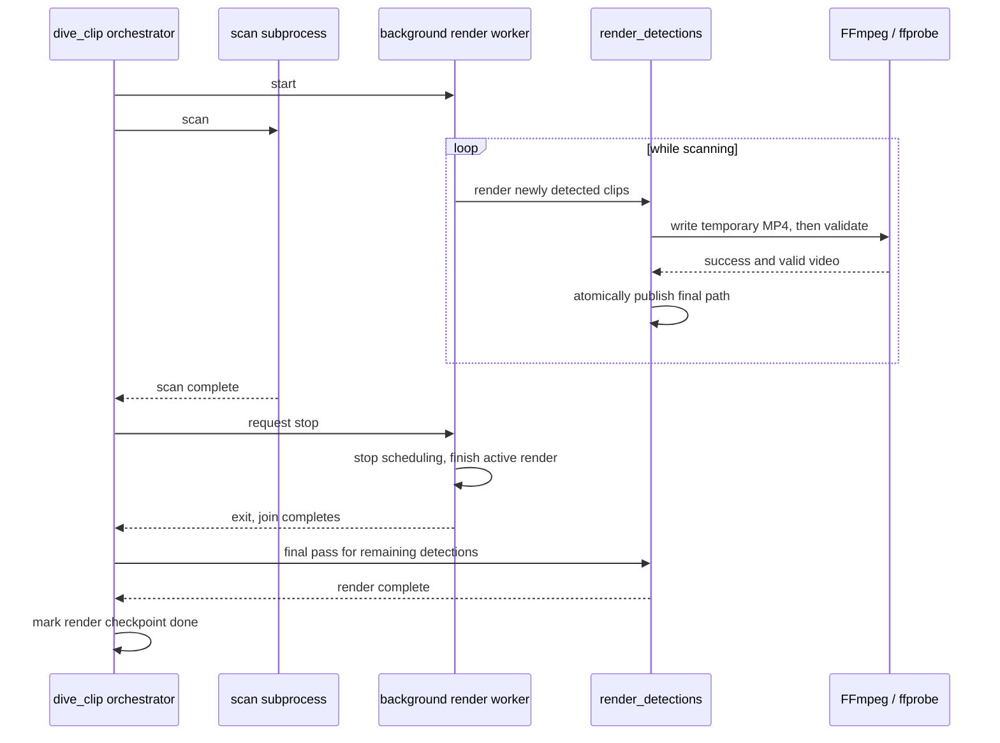

# Architecture Plan: [Issue #45] Make scan-time rendering safe

- **Issue**: [#45](https://github.com/tiwu/dive-clip-tui/issues/45)
- **Status**: Plan Review
- **Author**: Autonomous Agent / Contributor
- **Date**: 2026-11-01
- **Target Branch**: `feature/issue-45-make-scan-time-rendering-safe`

---

## 1. Problem Statement & Motivation

`dive-clip scan` starts a background thread that renders detections while scanning. When scanning ends, the orchestrator signals the worker and waits only two seconds before launching the final renderer. An FFmpeg render can outlast that wait, so both renderers can write the same output.

`render_clip()` writes directly to the final MP4 path. If FFmpeg fails or is interrupted after creating a nonempty file, `render_detections()` treats that file as complete and skips it on retry. The pipeline can therefore preserve an incomplete clip across resume.

Keep scan/render overlap, but make worker ownership explicit and publish outputs only after successful rendering and validation. Preserve the existing detections, clip names, output layout, and pipeline checkpoint schema.

## 2. Requirements & Acceptance Criteria

- [ ] The background worker stops scheduling clips when shutdown begins and finishes its active render before the final renderer starts.
- [ ] The final renderer never starts while the background worker can write to the same output.
- [ ] FFmpeg writes to a temporary MP4 beside the destination. Publish with an atomic replace only after FFmpeg succeeds and `ffprobe` confirms a valid video stream and positive duration.
- [ ] Failed, timed-out, or interrupted renders do not leave a final-path file that is mistaken for a completed clip. Clean temporary output on handled failures; retry it on resume.
- [ ] Existing nonempty but invalid outputs are rejected and rendered again rather than skipped.
- [ ] A normal run and a resumed run produce one valid final MP4 per detection, with no duplicate writers.
- [ ] Preserve scan-time overlap, current output names and paths, and render-step checkpoint behavior. Do not change data models or checkpoint schema.
- [ ] Focused tests cover worker shutdown ordering, atomic publication, invalid-output retry, and interruption/resume behavior.

### Architecture and data flow

Keep orchestration in `scripts/dive_clip.py` and rendering logic in `scripts/05_render_clips.py`. Do not add a new module or synchronization framework for this single worker.

Keep per-clip file creation and validation in `render_detections()` / `render_clip()`. Add a shutdown check between detections so the worker finishes its active FFmpeg render but starts no new clip after stop is requested. The orchestrator must join it fully before invoking the final render subprocess. Bound FFmpeg and ffprobe with explicit timeouts, and surface validation failures through the existing render failure/logging path.

The completed final path is the publication signal. Write temporary files in the destination directory so atomic replacement stays on one filesystem. Give temporary files an MP4 suffix so FFmpeg selects the expected container. On a handled failure, timeout, or interrupt, remove the temporary file. On resume, ignore temporary files and retry detections whose final output is absent or invalid.

The render step remains marked complete only after the final render subprocess succeeds. The worker does not change `PipelineState`; a scan interrupted before final rendering remains resumable. No manifest, detection, or checkpoint migration is needed.

### Compatibility and trade-offs

- Output names and folder layout remain unchanged; consumers continue to see only final `.mp4` files.
- The final stage may wait for the active background render, bounded by the current 300-second FFmpeg timeout plus the bounded probe time. This is required to preserve single-writer ownership.
- `ffprobe` adds a small validation subprocess for newly rendered and previously existing outputs. Reuse an existing helper only if it can verify a video stream and positive duration without weakening error reporting; otherwise keep the narrow check local to the render module.
- A process killed without cleanup may leave a temporary file, but it cannot be mistaken for a completed clip. A later render can safely ignore it.

## 3. Change Log and Release Impact

- **Change category**: Fixed
- **Proposed SemVer impact**: `semver:patch`
- **Draft changelog entry**: Prevent scan-time and final clip renders from racing, and retry incomplete clips safely after interruption.

## 4. Test-Driven Development (TDD) Plan

1. **Red (Tests First)**:
   - In `tests/test_dive_clip.py`, use synchronization events to prove the final render subprocess is not launched until the background worker exits. Avoid timing-based sleeps.
   - In `tests/test_render_clips.py`, verify FFmpeg targets a temporary path, successful validated output is atomically promoted, and failure, timeout, or interruption leaves no final-path partial file.
   - Verify an invalid nonempty existing MP4 is not skipped and is retried.
   - Simulate an interrupted render followed by resume; assert one valid final output per detection and no duplicate render after successful publication.
2. **Green (Implementation)**:
   - Update worker shutdown and join ordering in `scripts/dive_clip.py`, retaining overlap and preventing new work after stop is requested.
   - Update `scripts/05_render_clips.py` to stage, validate, and atomically publish clip files; only skip valid outputs.
   - Keep pipeline state and data contracts unchanged.
3. **Refactor & Quality**:
   - Run focused tests: `uv run python -m pytest tests/test_dive_clip.py tests/test_render_clips.py tests/test_run_resume.py`
   - Run the full suite: `uv run python -m pytest`
   - Check changed Python files: `uv run ruff check scripts/dive_clip.py scripts/05_render_clips.py tests/test_dive_clip.py tests/test_render_clips.py` and `uv run ruff format --check` on those files.

## 5. Verification & Rollout Checklist

- [ ] Focused concurrency, atomic-output, invalid-output, and resume tests pass.
- [ ] Full test suite passes.
- [ ] Changed Python files pass Ruff lint and formatting checks.
- [ ] `CHANGELOG.md` updated under `[Unreleased]` in the implementation PR.
- [ ] PR uses `semver:patch` and includes `Closes #45` with this plan linked.
