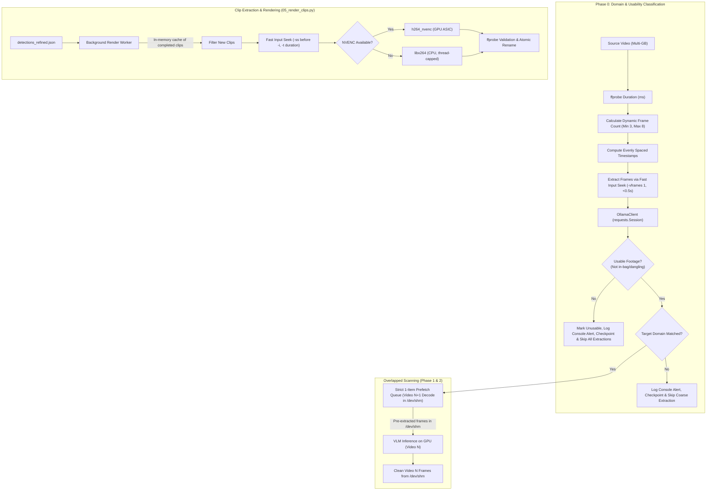

# Architecture Plan: [Issue #52] Full run review: Hardware-accelerated encoding, dynamic sampling, and pipeline optimization

- **Issue**: [#52](https://github.com/tiwu/dive-clip-tui/issues/52)
- **Status**: Plan Review
- **Author**: Autonomous Agent / Contributor
- **Date**: 2026-11-02
- **Target Branch**: `feature/issue-52-full-run-review`

---

## 1. Problem Statement & Motivation

During a full pipeline scan on a large dataset of 111 videos (`run-20261101-182529`, 6.5 hours total runtime), diagnostics revealed significant hardware imbalance and execution bottlenecks:

1. **CPU Saturation & Thermal Spikes from Software Encoding**:
   - FFmpeg clip rendering in `scripts/05_render_clips.py` and `scripts/07_create_aftermovie.py` is hardcoded to CPU software encoding (`-c:v libx264`).
   - Default FFmpeg thread allocation spawned up to 84 threads, consuming 100% of CPU cores, causing thermal throttling and starving background I/O, frame sampling, and Ollama request dispatching.
2. **GPU & Dedicated ASIC Underutilization**:
   - The NVIDIA GeForce RTX 3060 dedicated NVENC hardware encoding ASIC remained at 0% utilization throughout the run, consuming extra CPU cycles while the GPU was idle between VLM prompt inference batches.
3. **Severe Seeking Inefficiency Leading to Render Timeouts**:
   - In `scripts/05_render_clips.py`, `render_clip()` places `-ss` *after* the input flag (`-i <source> -ss <start> -to <end>`). In FFmpeg, output seeking forces software decoding of every frame from 0.0s up to `start_time`.
   - On 4K 60fps high-bitrate action footage, extracting a 2-second highlight at minute 10 required decoding 10 minutes of 4K video on the CPU, causing multiple clip renders to exceed the 300-second subprocess timeout and fail.
4. **Full File Decode for Pass 0 Sample Frames**:
   - In `scripts/02_scan_footage.py`, both `extract_classification_frames()` and `scan_footage()` run `extract_frames(..., fps=0.25)` across the **entire video duration from start to finish** before selecting sample frames.
   - On multi-gigabyte 4K files, hundreds or thousands of frames are decoded and written to disk just to pick 3 sample frames.
5. **No Usability Filtering in Pass 0 (Wasted Inference on In-Bag / Dangling Footage)**:
   - Pass 0 prompts only for domain classification (`underwater`, `motorcycle`, `generic`) without assessing camera state.
   - Upside-down, dangling, in-bag, or covered-lens footage is labeled as a domain, triggering full coarse extraction and hundreds of wasteful VLM calls in Phase 1 before being rejected frame by frame.
6. **Fixed Sample Frame Count Ignoring Video Duration**:
   - Pass 0 currently samples a static 3 frames regardless of whether a video is 15 seconds or 45 minutes long, leaving large temporal blind spots in long recordings.
7. **Sequential Lockstep Stalling GPU**:
   - Video processing is locked in sequential lockstep: Video $N$ decodes frames on CPU while GPU is at 0%, then Video $N$ sends inference to Ollama while CPU decoders idle. The GPU is repeatedly starved waiting for FFmpeg frame extraction.
8. **Unpooled HTTP Connection Churn**:
   - `OllamaClient.generate()` calls `requests.post()` directly, creating and tearing down a new TCP connection for each of the 4,800+ frame inference calls.
9. **Worker Polling Contention**:
   - The background render worker polls `detections_refined.json` every 1 second and scans the filesystem repeatedly against all detections, increasing disk contention on external storage volumes.

---

## 2. Requirements & Acceptance Criteria

### Functional Requirements

- [ ] **Hardware-Accelerated NVENC Encoding**:
  - Support `h264_nvenc` for clip rendering (`05_render_clips.py`) and aspect ratio conversion in aftermovie creation (`07_create_aftermovie.py`).
  - Provide an automatic hardware detection mechanism (`auto`) that probes for NVENC availability and falls back gracefully to `libx264` if NVENC is unavailable, unsupported, or fails during encoding.
  - Allow explicit encoder configuration in `config.yaml` (`video_encoder: "auto" | "h264_nvenc" | "libx264"`).
- [ ] **Fast Input Seeking for Clip Renders**:
  - In `05_render_clips.py`, place `-ss` before `-i` (input seek) and specify clip length via `-t <duration>` (or seek-relative endpoint).
  - Ensure keyframe-accurate cuts without decoding the entire preceding stream, preventing 300s render timeouts on long videos.
- [ ] **Instant Targeted Frame Extraction for Pass 0**:
  - Instead of decoding the entire video at 0.25 FPS to extract sample frames, probe video duration via `ffprobe` (reading metadata only in milliseconds) and extract only the target sample frames using fast input seeks:
    `ffmpeg -ss <timestamp> -i <video> -vframes 1 -vf scale=<scale> -qscale:v 2 <output_path>`
  - Pass 0 sample frame extraction drops from minutes of full-file decoding to < 0.5s per video.
- [ ] **Dynamic Sample Frame Scaling by Duration**:
  - Dynamically scale sample count with video length: minimum `classify_frames_count` (default 3), adding 1 frame per `classify_interval_seconds` (default 300s / 5 min), capped at `classify_frames_max` (default 8).
  - Ensures long recordings are sampled representatively across their entire duration.
- [ ] **Pass 0 Usability & Orientation Screening (Early Exit)**:
  - Add camera usability checks to `VIDEO_CLASSIFICATION_PROMPT`: detect covered lenses, in-bag recordings, and upside-down/dangling clips.
  - If sampled frames are consistently unusable, classify the clip as `usable: false` / `domain: "unusable"` and immediately abort Phase 1 and Phase 2, avoiding hundreds of wasted VLM calls.
- [ ] **Early Exit on Domain Rejection**:
  - Execute Pass 0 domain classification *before* running full coarse frame extraction.
  - If a clip's classified domain does not match the configured/target domain (e.g. `generic` when processing underwater footage), skip extracting coarse frames for that file entirely.
- [ ] **Console Feedback & Run Stats Transparency for Skipped Clips**:
  - Clearly report skipped clips in the CLI console (e.g., `⚡ Skipped GX010833.MP4: unusable camera footage (inside bag / dangling)`).
  - Record `clips_unusable` and `clips_skipped_domain` counters in `run_stats.json`.
- [ ] **Immediate Checkpointing of Early Exits**:
  - When a clip is rejected early, record its status immediately to `pipeline_state.json` / checkpoints so `--resume` skips it without re-probing or re-classifying.
- [ ] **Strictly Bounded Prefetch Queue (`buffer_size=1`)**:
  - Overlap coarse frame extraction of Video $N+1$ with VLM inference on Video $N$ using a bounded prefetch worker strictly capped at 1 item in `/dev/shm`, preventing memory exhaustion.
  - Delete temporary frames for Video $N$ immediately when its fine scan finishes before promoting Video $N+1$.
- [ ] **HTTP Connection Pooling in `OllamaClient`**:
  - Maintain a persistent `requests.Session()` in `OllamaClient` to reuse open HTTP/1.1 connections across all frame inference requests, eliminating socket creation and teardown overhead across thousands of calls.
- [ ] **CPU Thread & Resource Bounding**:
  - When falling back to `libx264`, cap FFmpeg thread usage (e.g. `-threads 4` or configurable) to prevent CPU starvation of frame extraction, system I/O, and Ollama inference.
- [ ] **Worker In-Memory State & Metrics**:
  - The background render worker tracks already-rendered clip IDs in memory during the run to minimize unnecessary disk `stat()` and validation calls on external drives.
  - Render statistics (clips rendered, skipped, failed, duration, elapsed time) are accurately captured and persisted in `run_stats.json`.
- [ ] **Compatibility & Resilience**:
  - Maintain identical output MP4 naming conventions (`clip_<id>_<start>s-<end>s_<subject>_q<score>.mp4`), atomic temporary file staging, and validation via `ffprobe`.
  - Ensure clean operation on systems without NVIDIA GPUs (macOS, Linux AMD/Intel, CPU-only CI environments).

---

## 3. Architecture & Data Flow

### Component Details:

1. **`utils/models.py`**:
   - Extend `ClipClassification` with optional `usable: bool = True` and `quality_score: int | None = None`.
   - Extend `Phase0Stats` / `RunStats` with `clips_unusable: int = 0` and `clips_skipped_domain: int = 0`.
2. **`utils/prompt_templates.py`**:
   - Update `VIDEO_CLASSIFICATION_PROMPT` to ask the VLM:
     - `usable: bool`: `false` if the lens is covered/black, camera is inside a bag/pocket, or camera is tumbling/dangling on a lanyard.
     - `quality_score: int`: 1-10 rubric (1-3 for in-bag/dangling/chaotic, 4+ for usable footage).
3. **`utils/ffmpeg_streamer.py` / `scripts/02_scan_footage.py`**:
   - `calculate_sample_timestamps(duration, min_count, interval_seconds, max_count)`: returns evenly spaced timestamps across video duration.
   - `extract_sample_frames(video_path, timestamps, scale, output_dir)`: extracts single frames via `-ss <ts> -i <video> -vframes 1`.
   - `aggregate_frame_classifications()`: marks clip `usable: false` / `domain: "unusable"` if sampled frames are consistently unusable.
   - `scan_footage()` runs Pass 0 *before* allocating coarse frames; skips coarse extraction if unusable or domain rejected, logs terminal alerts, and flushes to checkpoints immediately.
   - Producer-consumer queue bounded to `buffer_size=1` in `/dev/shm` to prefetch coarse frames for Video $N+1$ while Video $N$ executes inference. Cleanly unlinks `/dev/shm` frames after inference.
4. **`utils/ollama_client.py`**:
   - Initialize and reuse `requests.Session()` on `OllamaClient` across requests.
5. **`utils/encoder.py` (or helper in `utils/config.py`)**:
   - Probes whether `h264_nvenc` is functional (`ffmpeg -f lavfi -i testsrc=duration=1:size=320x240:rate=1 -c:v h264_nvenc -f null -`).
   - Caches probe results for process lifecycle.
   - Returns encoder parameters: e.g. `["-c:v", "h264_nvenc", "-preset", "p4"]` or `["-c:v", "libx264", "-threads", "4", "-preset", "veryfast"]`.
6. **`scripts/05_render_clips.py`**:
   - `render_clip()` updated to use fast input seek (`-ss <start> -i <source> -t <duration>`) and hardware encoding with automatic fallback.
7. **`scripts/07_create_aftermovie.py`**:
   - Aspect ratio conversion adopts configured/detected video encoder parameters.

---

## 4. Change Log and Release Impact

- **Change category**: Changed
- **Proposed SemVer impact**: `semver:minor`
- **Draft changelog entry**: Add hardware-accelerated NVENC video encoding with automatic fallback, fast input seeking for highlight renders, dynamic duration-based Pass 0 frame sampling with in-bag/dangling footage rejection, connection pooling in OllamaClient, and memory-bounded pipelined frame extraction prefetching.

---

## 5. Test-Driven Development (TDD) Plan

### Tier 1: Instant Core Wins (Seeking, NVENC, Targeted Sampling, Usability Drop, Connection Pool)
1. **Red (Tests First)**:
   - `tests/test_encoder.py`: Unit tests for encoder probe, auto-selection, manual config overrides, and error fallback.
   - `tests/test_ollama_client.py`: Test that `OllamaClient` uses a persistent `requests.Session()` across multiple calls.
   - `tests/test_render_clips.py`: Assert `-ss` appears before `-i`, verify `-t` duration flag, test NVENC parameter pass-through, and verify fallback to CPU when hardware encode fails.
   - `tests/test_scan_footage.py`:
     - Test dynamic timestamp calculation scaling with video duration.
     - Test targeted sample extraction without full-file decoding.
     - Test that in-bag / dangling frames cause `usable=False` / `domain="unusable"`.
     - Test that non-target or unusable clips skip coarse frame extraction and record immediately to checkpoints.
     - Test console reporting and stats counters for skipped clips.
   - `tests/test_create_aftermovie.py`: Verify aspect ratio conversion command incorporates selected encoder arguments.
2. **Green (Implementation)**:
   - Implement encoder detection helper with caching and fallback.
   - Implement session pooling in `OllamaClient`.
   - Implement dynamic sampling, usability prompt updates, early-exit logic, and immediate checkpoint persistence.
   - Update `scripts/05_render_clips.py` with fast input seeking, encoder parameters, and fallback retry.
   - Update `scripts/07_create_aftermovie.py` to use detected/configured encoder.
   - Update `config.yaml` with documented `video_encoder`, `classify_interval_seconds`, and `classify_frames_max` parameters.

### Tier 2: Throughput Polishing (1-Item Prefetch Queue)
1. **Red (Tests First)**:
   - Test 1-item prefetch queue bound (`buffer_size=1`) and verify immediate `/dev/shm` frame cleanup after inference.
2. **Green (Implementation)**:
   - Implement single-item producer-consumer queue in `scan_footage()`.
3. **Refactor & Quality**:
   - Run focused test suite: `uv run python -m pytest tests/test_render_clips.py tests/test_scan_footage.py tests/test_ollama_client.py tests/test_create_aftermovie.py`
   - Run full test suite: `uv run python -m pytest`
   - Check Ruff linting and formatting: `uv run ruff check .` and `uv run ruff format --check .`

---

## 6. Verification & Rollout Checklist

- [ ] All automated tests pass (`uv run python -m pytest`).
- [ ] Benchmark test confirms input seeking and NVENC dramatically reduce render time and CPU utilization.
- [ ] Pass 0 dynamic targeted extraction benchmark confirms instant frame sampling without full video decoding.
- [ ] Usability screening verified to drop in-bag / dangling footage in < 2s with clear terminal feedback.
- [ ] 1-item bounded prefetch queue verified to keep memory bounded in `/dev/shm`.
- [ ] Session pooling verified in `OllamaClient`.
- [ ] Changed files adhere to Ruff formatting and linting rules.
- [ ] Issue #52 body updated with plan link and label set to `agent:plan-review`.
- [ ] Wait for user approval (`agent:approved`) before starting Stage 2 implementation.
