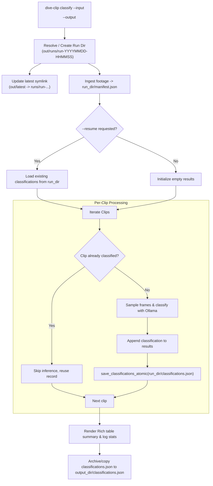

# Architecture Plan: [Issue #55] Add run directory structure, incremental saving, and resume support to dive-clip classify

- **Issue**: [#55](https://github.com/tiwu/dive-clip-tui/issues/55)
- **Status**: In Progress
- **Author**: Autonomous Agent / Contributor
- **Date**: 2026-11-02
- **Target Branch**: `feature/issue-55-classify-run-dir-and-incremental-storage`

---

## 1. Problem Statement & Motivation

Standalone Pass 0 domain classification (`dive-clip classify`) currently differs from the rest of the pipeline in two critical ways:

1. **No Standard Run Directory or Symlink**:
   - Unlike `dive-clip scan`, which creates `<output_dir>/runs/run-YYYYMMDD-HHMMSS/` and maintains `<output_dir>/latest`, `cmd_classify` writes directly to a single file at `<output_dir>/classifications.json` (or the `--output` path).
   - It does not archive run logs, ingested manifests, or execution metadata into timestamped run folders.

2. **No Incremental Result Storage**:
   - In `scripts/02_scan_footage.py`, `classify_footage()` accumulates classifications in an in-memory list `results = []` and only writes `classifications.json` once at the very end.
   - On large footage batches (such as 111 videos taking 25–35+ minutes), no files are created or updated in the output directory while the scan runs. Users have no visibility into on-disk progress.

3. **No Resume Support**:
   - If an ongoing classification run is interrupted (e.g. by SIGINT, network failure, or system shutdown), all progress is lost and the next run must re-classify every video from scratch.

---

## 2. Requirements & Acceptance Criteria

### Functional Requirements

- [x] **Timestamped Run Directory & `latest` Symlink**:
  - `dive-clip classify` creates a standard timestamped run directory `<output_dir>/runs/run-<timestamp>/` via `get_run_dir()`.
  - Creates or updates the `<output_dir>/latest` symlink pointing to the current run directory.
  - Places `classifications.json`, `manifest.json`, and `classify.log` inside the run directory.
  - Also copies/links `classifications.json` to `<output_dir>/classifications.json` (or `<output_dir>/latest/classifications.json`) for backwards compatibility with default `--output` paths and downstream consumers (`dive-clip scan --classifications <path>`).
  - When `--output` is explicitly passed as a file path ending in `.json`, that file is written and the run directory also preserves the run snapshot.

- [x] **Incremental Atomic Persistence**:
  - `classify_footage()` in `scripts/02_scan_footage.py` accepts an optional `output_file: Path | None` parameter.
  - After each clip is classified, `classify_footage()` writes the updated `ClassificationOutput(total_clips=len(results), classifications=results)` atomically to disk using a temporary file and rename (`save_classifications_atomic`).
  - Users and external observers can monitor `classifications.json` on disk to inspect completed clips in real time.

- [x] **Resume Support (`--resume`)**:
  - Add `--resume` (flag or optional run ID / path) to `dive-clip classify`.
  - When resuming, `cmd_classify` detects previously classified clips in the target run directory (or `latest`), loads existing valid classifications, and skips clips that already have confident or recorded classifications.
  - Appends new results incrementally into `classifications.json`.

- [x] **State & Execution Metadata**:
  - Record execution metadata (`run_id`, `input_dir`, `output_dir`, `config_path`) using `PipelineState` in `<run_dir>/pipeline_state.json`.

---

## 3. Architecture & Data Flow

---

## 4. Change Log and Release Impact

- **Change category**: Added
- **Proposed SemVer impact**: `semver:minor`
- **Draft changelog entry**:
  - Add timestamped run directory archiving (`runs/run-YYYYMMDD-HHMMSS/`) and `latest` symlink creation to `dive-clip classify`.
  - Add atomic incremental result saving after each clip during domain classification.
  - Add `--resume` support to `dive-clip classify` to resume interrupted classification runs.

---

## 5. Test-Driven Development (TDD) Plan

1. **Red (Tests First)**:
   - In `tests/test_classify.py`, add unit and integration tests:
     - `test_cmd_classify_creates_run_dir_and_symlink`: verify that running `dive-clip classify` without `--output` or with `--output <dir>` creates `runs/run-<timestamp>` and updates `latest`.
     - `test_classify_footage_incremental_save`: verify that passing `output_file` to `classify_footage()` causes the file to be atomically updated after every clip iteration.
     - `test_cmd_classify_resume`: verify that interrupted classification runs can be resumed using `--resume`, preserving previously classified clips and only classifying remaining clips.
2. **Green (Implementation)**:
   - In `scripts/dive_clip.py`: update `cmd_classify` and parser to initialize `run_dir`, `update_latest_symlink`, save `manifest.json`, support `--resume`, and pass `output_file` to `classify_footage`.
   - In `scripts/02_scan_footage.py`: update `classify_footage()` to support `output_file`, write atomically after each clip via `save_classifications_atomic()`, and support skipping already-classified clips when resuming.
3. **Refactor & Quality**:
   - Verify `uv run python -m pytest tests/test_classify.py` passes.
   - Run the full test suite (`uv run python -m pytest`).
   - Run Ruff linting and formatting on changed files.

---

## 6. Verification & Rollout Checklist

- [x] Tests pass: `uv run python -m pytest`
- [x] Changed Python files pass Ruff lint and formatting checks: `uv run ruff check .` and `uv run ruff format --check .`
- [x] `CHANGELOG.md` updated under `[Unreleased]` with `Added` entry
- [ ] PR linked with `Closes #55` and plan referenced
