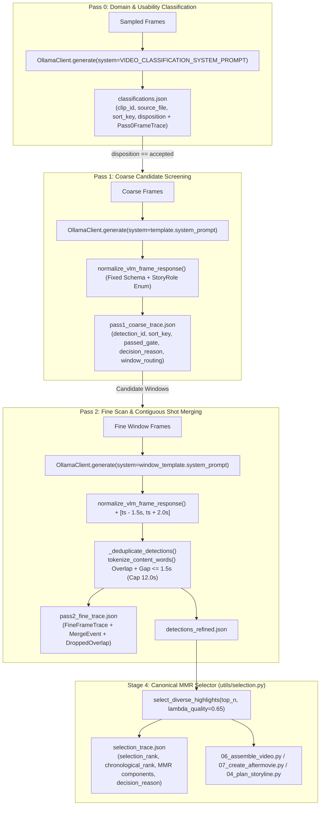

# Architecture Plan: [Issue #61] Broaden highlight diversity (MMR), contiguous shot merging, story-role prompts, and per-stage decision traceability

- **Issue**: [#61](https://github.com/tiwu/dive-clip-tui/issues/61)
- **Status**: Plan Review
- **Author**: Autonomous Agent / Contributor
- **Date**: 2026-11-03
- **Target Branch**: `feature/issue-61-highlight-diversity-merging-and-story-prompts`
- **Research Reference**: [`docs/research/highlight-detection-and-telemetry.md`](../research/highlight-detection-and-telemetry.md)

---

## 1. Problem Statement & Motivation

Based on our primary-source research investigation ([`docs/research/highlight-detection-and-telemetry.md`](../research/highlight-detection-and-telemetry.md)), our current pipeline technically completes end-to-end but suffers from four critical shortcomings that limit highlight quality and prevent iterative tuning:

1. **Lack of Per-Stage Decision Traceability (Lost Diagnostic Signals)**:
   - During a full `dive-clip scan`, Pass 0 calls `classify_clip_domain()` and discards the underlying `ClipClassification` object and per-frame responses.
   - Pass 1 (coarse frame screening) and Pass 2 (fine frame scoring) evaluate thousands of frames, but `remove_clip_checkpoint()` deletes the per-clip checkpoint file as soon as each clip finishes (`scripts/02_scan_footage.py:1943`).
   - `_deduplicate_detections()` and top-N video assembly silently merge or discard detections without recording *why* a frame, window, or clip was selected, merged, or rejected. When reviewing an earlier run folder (`<output_dir>/runs/run-<timestamp>/`), there is no audit trail to learn why good moments were missed or why mediocre ones were chosen.
2. **Fixed `±1.0s` Micro-Windows & Brittle Exact-String Deduplication (`scripts/02_scan_footage.py`)**:
   - Pass 2 emits hardcoded `2.0s` windows (`[ts - 1.0, ts + 1.0]`). In `07_create_aftermovie.py`, a `1.0s` fade-in and `1.0s` fade-out consumes 100% of a `2.0s` clip.
   - Worse, `_deduplicate_detections()` groups contiguous detections strictly by exact lowercase subject string equality (`(det.clip_id, det.subject.strip().lower())`). When Qwen2.5-VL labels consecutive frames `0.5s` apart as `"green sea turtle"` and `"sea turtle swimming"`, they fail to merge in Step 1 and instead cannibalize each other during Step 2 overlap deletion.
3. **Greedy Quality-Only Top-N Selection (`scripts/06_assemble_video.py`, `scripts/07_create_aftermovie.py`, `scripts/04_plan_storyline.py`)**:
   - Selection is currently `sorted(detections, key=lambda d: d.get("quality_score", 0), reverse=True)[:top_n]`.
   - If a single clip has good lighting where coral or a road scores `9/10` across 10 windows, all 10 clips in the highlight reel come from that single video and subject while the rest of the input folder is ignored.
   - Selected clips remain sorted by `quality_score` descending rather than chronological order, causing the assembled video to jump randomly back and forth across files and timestamps.
4. **Closed-World "Noun Checklist" Prompt Tunnel Vision & Dead `system_prompt` (`utils/prompt_templates.py`, `utils/ollama_client.py`)**:
   - Built-in coarse and fine prompts instruct the VLM to reject frames unless predefined target nouns (`pelagics`/`macro`/`diver` or `moto_riding`/`moto_scenic`/`moto_group`) are present, discarding essential story beats (gearing up on the boat/roadside, giant-stride water entry, sunbeams, buddy high-fives, campfires, or unexpected moments).
   - In Pass 2, `window_routing` locks each merged coarse window to a single specialist template (e.g., `PELAGICS_TEMPLATE`), rejecting secondary subjects (e.g., divers or macro) inside that same window.
   - Additionally, `PromptTemplate.system_prompt` is defined across all templates in `utils/prompt_templates.py` but never passed in `OllamaClient.generate()` or `call_ollama()`.

---

## 2. Locked Technical Contracts

### 2.1 Tokenization, Contiguous Window Merging, & Canonical MMR Contract (`utils/selection.py` & `scripts/02_scan_footage.py`)

`utils/selection.py` is the **single canonical selection primitive** used by `06_assemble_video.py`, `07_create_aftermovie.py`, and `04_plan_storyline.py`. Neither assembly scripts nor storyline planning may re-implement sorting, filtering, or MMR logic.

#### A. Deterministic Content-Word Tokenizer (`tokenize_content_words(text: str) -> frozenset[str]`)
- Extract lowercase alphanumeric tokens via `re.findall(r"[a-z0-9]+", (text or "").lower())`.
- Filter out tokens with `len(token) < 3` and tokens in the deterministic stopword set:
  ```python
  STOPWORDS: frozenset[str] = frozenset({
      "the", "and", "for", "with", "from", "into", "over", "under", "near",
      "through", "while", "some", "two", "three", "clear", "good", "shot",
      "view", "frame", "scene", "clip", "video", "camera", "action",
      "highlight", "swimming", "moving", "riding", "looking", "showing",
      "visible", "water", "underwater", "road", "unknown", "none",
  })
  ```
- Example:
  - `"green sea turtle"` → `{"green", "sea", "turtle"}`
  - `"sea turtle swimming"` → `{"sea", "turtle"}`
  - `"hawksbill turtle"` → `{"hawksbill", "turtle"}`
  - All three share the content token `"turtle"`.

#### B. Contiguous Window Merge Policy in `_deduplicate_detections()`
For detections within the same `clip_id`, sorted deterministically by `(start_time, end_time, -quality_score, -confidence)`:
- Two windows `prev` and `curr` merge into `[prev.start_time, max(prev.end_time, curr.end_time)]` if and only if **all three conditions** hold:
  1. **Temporal adjacency:** `curr.start_time <= prev.end_time + merge_gap_seconds` (default `1.5s`).
  2. **Subject match:** Either `prev.subject.strip().lower() == curr.subject.strip().lower()` OR `bool(tokenize_content_words(prev.subject) & tokenize_content_words(curr.subject))` (at least one shared content token of length ≥ 3, so single-character test subjects like `"a"` and `"b"` remain distinct).
  3. **Duration cap:** `max(prev.end_time, curr.end_time) - prev.start_time <= max_clip_duration` (default `12.0s`). If conditions (1) and (2) hold but merging would exceed `max_clip_duration`, `curr` starts a new segment and a `MergeEvent` with `action="split_max_duration"` is recorded in `pass2_fine_trace.json`.

#### C. Canonical MMR Scoring Formula (`select_diverse_highlights`)
Given candidate detections `D`, target count `top_n`, trade-off parameter `lambda_quality` ∈ `[0.0, 1.0]` (default `0.65`), and optional `max_per_clip`:

1. **Intrinsic Relevance Score (`R(d)` ∈ `[0.0, 1.0]`):**
   ```python
   R(d) = 0.85 * (clamp(d.quality_score, 1, 10) / 10.0) + 0.15 * clamp(d.confidence, 0.0, 1.0)
   ```
2. **Pairwise Similarity (`S(d_i, d_j)` ∈ `[0.0, 1.0]`):**
   ```python
   S(d_i, d_j) = (
       0.50 * J_subj(d_i, d_j)
       + 0.20 * J_desc(d_i, d_j)
       + 0.15 * I_cat(d_i, d_j)
       + 0.15 * T_prox(d_i, d_j)
   )
   ```
   Where:
   - **`J_subj(d_i, d_j)`:** `1.0` if `subj_i == subj_j` (non-empty lowercase); else Jaccard similarity `len(A & B) / len(A | B)` on `tokenize_content_words(subject)` (`0.0` if either set is empty).
   - **`J_desc(d_i, d_j)`:** Jaccard similarity `len(A & B) / len(A | B)` on `tokenize_content_words(description)` (`0.0` if either set is empty).
   - **`I_cat(d_i, d_j)`:** `1.0` if both share the same non-empty `template` or `story_role` (excluding `"none"`), else `0.0`.
   - **`T_prox(d_i, d_j)`:** Temporal proximity penalty within the same source clip:
     - `0.0` if `d_i.clip_id != d_j.clip_id`
     - `max(0.0, 1.0 - abs(mid(d_i) - mid(d_j)) / 60.0)` if `d_i.clip_id == d_j.clip_id`, where `mid(d) = (d.start_time + d.end_time) / 2.0`.
3. **Per-Clip Soft Quota Penalty (`Q(d, Selected)`):**
   - Let `U = len({x.clip_id for x in D})` be the number of unique clips with detections.
   - `per_clip_limit = max_per_clip if max_per_clip is not None else max(1, math.ceil(top_n / max(1, U)))`.
   - If the number of already-selected clips from `d.clip_id` is `>= per_clip_limit`, `Q(d, Selected) = 0.35`; otherwise `0.0`.
4. **Iterative Greedy MMR Step:**
   At each step `k = 1 .. min(top_n, len(D))`, pick `d*` from `D - Selected` maximizing:
   ```python
   max_sim = max((S(d, s) for s in Selected), default=0.0)
   MMR(d) = round(lambda_quality * R(d) - (1.0 - lambda_quality) * max_sim - Q(d, Selected), 6)
   ```
   - **Deterministic Tie-Breaker:** Ties in `MMR(d)` are broken by `(-d.quality_score, -d.confidence, d.sort_key)`.
5. **Canonical Output Sort Order:**
   - Once the `top_n` set is chosen (with `selection_rank` `1..K` recorded), the returned list is sorted chronologically by `sort_key` (`(source_file, start_time, end_time, clip_id)`) and stamped with `chronological_rank` `1..K`.

---

### 2.2 Concrete `system_prompt` Payload Contract (`utils/ollama_client.py` → `scripts/02_scan_footage.py`)

1. **`OllamaClient.generate()` Signature & Payload (`utils/ollama_client.py`)**:
   ```python
   def generate(
       self,
       image_path: str,
       prompt: str,
       phase: str = "unspecified",
       system_prompt: str | None = None,
   ) -> dict[str, Any] | None:
   ```
   - Base JSON payload sent to `POST {self.host}/api/generate`:
     ```python
     payload: dict[str, Any] = {
         "model": self.model,
         "prompt": prompt,
         "images": [image_b64],
         "format": "json",
         "stream": False,
     }
     if system_prompt and system_prompt.strip():
         payload["system"] = system_prompt.strip()
     ```
2. **`call_ollama()` Wrapper & Call Sites (`scripts/02_scan_footage.py`)**:
   - `call_ollama(..., system_prompt: str | None = None)` forwards `system_prompt=system_prompt` to `request_client.generate(image_path, prompt, phase, system_prompt=system_prompt)`.
   - **Pass 0 (`classify_clip`):** Passes `system_prompt=VIDEO_CLASSIFICATION_SYSTEM_PROMPT` (`"You are an expert video analyst specializing in action camera and smartphone footage classification and technical quality assessment."`).
   - **Pass 1 (`process_clip` coarse scan):** Resolves `coarse_system_prompt = matched_template.system_prompt if matched_template else dom_config.fallback_template.system_prompt` and passes `system_prompt=coarse_system_prompt`.
   - **Pass 2 (`process_clip` fine scan):** Passes `system_prompt=window_template.system_prompt`.

---

### 2.3 Fixed VLM JSON Schema & Story-Role Normalization Contract (`utils/prompt_templates.py` & `utils/models.py`)

To prevent open-world story-role prompts from producing arbitrary or unparseable JSON fields:
1. **Closed Enum for `story_role`:**
   ```python
   StoryRole = Literal[
       "establishing",
       "entry_transition",
       "hero_subject",
       "human_moment",
       "unexpected_event",
       "none",
   ]
   VALID_STORY_ROLES: frozenset[str] = frozenset({
       "establishing",
       "entry_transition",
       "hero_subject",
       "human_moment",
       "unexpected_event",
       "none",
   })
   ```
2. **Locked Pass 1 & Pass 2 VLM Response Schema:**
   All coarse and fine prompts instruct the model to return **only** a JSON object with these exact keys:
   ```json
   {
     "detected": true,
     "subject": "string (specific subject/action or 'none')",
     "category": "string (domain template name)",
     "story_role": "establishing | entry_transition | hero_subject | human_moment | unexpected_event | none",
     "confidence": 0.85,
     "quality_score": 8,
     "reject_reasons": ["list of strings, or empty list if detected is true"],
     "description": "string (concise visual and technical note)",
     "timestamp": 0.0
   }
   ```
3. **Strict Sanitization & Normalization Helper (`normalize_vlm_frame_response(raw: dict[str, Any]) -> dict[str, Any]`):**
   - Ignores any unexpected keys invented by the model.
   - Coerces `story_role`: if missing or not in `VALID_STORY_ROLES`, defaults to `"hero_subject"` when `detected` is `True` and `"none"` when `detected` is `False`.
   - Coerces `reject_reasons`: converts string or list to `list[str]`, defaulting to `[]`.
   - Clamps `confidence` to `[0.0, 1.0]` and `quality_score` to `[1, 10]` (`0` when `detected=False` and missing).

---

### 2.4 Stable Identifiers, Sort Keys, & Per-Stage Traceability Schemas (`utils/models.py`)

Every record across all traceability artifacts uses deterministic identifiers and canonical sort keys so runs remain diffable and reviewable as folders grow:

- **Canonical Sort Key & IDs:**
  - `clip_id: str` — e.g. `"clip_0d1044dfbbd01c35"`
  - `source_file: str` — basename of the source video (e.g. `"GX010875.MP4"`)
  - `start_time: float` and `end_time: float` (for window/detection records; for single-frame records in Pass 0/Pass 1/Pass 2, `start_time = timestamp` and `end_time = timestamp`)
  - `detection_id: str` — `f"{clip_id}_{start_time:08.2f}_{end_time:08.2f}"`
  - `sort_key: str` — `f"{source_file}:{start_time:08.2f}:{end_time:08.2f}:{clip_id}"`

| Artifact File in `<run_dir>/` | Top-Level Pydantic Model | Key Fields Retained Per Record |
| :--- | :--- | :--- |
| **`classifications.json`** | `ClassificationOutput` | `clip_id`, `source_file` (`file_name`), `sort_key`, `domain`, `suggested_domain`, `confidence`, `uncertain`, `usable`, `disposition` (`accepted` \| `skipped_unusable` \| `skipped_non_target_domain` \| `reused_from_input`), `reason`, `frame_evaluations` (list of `Pass0FrameTrace`: `timestamp`, `start_time`, `end_time`, `domain`, `confidence`, `usable`, `quality_score`, `reject_reasons`, `scene_description`) |
| **`pass1_coarse_trace.json`** | `Pass1TraceOutput` | Per-clip `Pass1ClipTrace` sorted by `sort_key`: `clip_id`, `source_file`, `detected_domain`, `template_used`, `coarse_threshold`, `coarse_quality_threshold`, `frame_traces` (list of `CoarseFrameTrace`: `detection_id`, `clip_id`, `source_file`, `timestamp`, `start_time`, `end_time`, `sort_key`, `detected`, `subject`, `category`, `story_role`, `confidence`, `quality_score`, `reject_reasons`, `description`, `passed_gate`, `decision_reason`, `candidate_window`), `merged_windows`, `window_routing` |
| **`pass2_fine_trace.json`** | `Pass2TraceOutput` | Per-clip `Pass2ClipTrace` sorted by `sort_key`: `clip_id`, `source_file`, `quality_threshold`, `fine_pre_roll_seconds`, `fine_post_roll_seconds`, `merge_gap_seconds`, `max_clip_duration`, `frame_traces` (`FineFrameTrace` with `window_index`, `detection_id`, `clip_id`, `source_file`, `start_time`, `end_time`, `sort_key`, `template`, `detected`, `subject`, `story_role`, `confidence`, `quality_score`, `reject_reasons`, `passed_gate`, `decision_reason`), `merge_events` (`MergeEvent`: `merged_detection_id`, `constituent_ids`, `matched_tokens`, `action`), `dropped_overlaps` (`DroppedOverlap`: `dropped_detection_id`, `dropped_subject`, `dropped_quality_score`, `superseded_by_detection_id`, `superseded_by_subject`, `superseded_by_quality_score`, `reason`) |
| **`selection_trace.json`** | `SelectionTraceOutput` | `top_n`, `lambda_quality`, `per_clip_limit`, `total_candidates`, `selected_count`, `candidates` (list of `SelectionCandidateTrace` sorted by `(selected desc, selection_rank asc, -mmr_score, sort_key)`: `detection_id`, `clip_id`, `source_file`, `start_time`, `end_time`, `sort_key`, `subject`, `story_role`, `template`, `quality_score`, `confidence`, `relevance_score`, `max_similarity_penalty`, `most_similar_selected_id`, `quota_penalty`, `mmr_score`, `selected`, `selection_rank`, `chronological_rank`, `decision_reason`) |

---

## 3. Requirements & Acceptance Criteria

- [ ] **1. Per-Stage Decision Traceability Artifacts (`utils/models.py`, `utils/run_archive.py`, `scripts/02_scan_footage.py`, `utils/selection.py`)**:
  - Persist `classifications.json`, `pass1_coarse_trace.json`, `pass2_fine_trace.json`, and `selection_trace.json` in `<output_dir>/runs/run-<timestamp>/` (and archive via `archive_run_artifacts()`).
  - Ensure every trace item contains `detection_id`, `clip_id`, `source_file`, `start_time`, `end_time`, and `sort_key`, plus `selection_rank` / `chronological_rank` in `selection_trace.json`.
- [ ] **2. Fuzzy Subject & Contiguous Shot Merging + Natural Clip Windows (`scripts/02_scan_footage.py`, `config.yaml`)**:
  - Use `fine_pre_roll_seconds: 1.5` and `fine_post_roll_seconds: 2.0` (`3.5s` minimum clip duration) directly in `process_clip()` and `config.yaml`.
  - Implement deterministic content-token overlap merging in `_deduplicate_detections()` (`merge_gap_seconds: 1.5`, `max_clip_duration: 12.0`) per Section 2.1.B.
- [ ] **3. Canonical MMR Highlight Selector (`utils/selection.py`, `06_assemble_video.py`, `07_create_aftermovie.py`, `04_plan_storyline.py`)**:
  - Implement `select_diverse_highlights()` per Section 2.1.C as the sole selection primitive across assembly and storyline scripts.
- [ ] **4. Open-World Story-Role Prompts, Fixed VLM Schema, & `system_prompt` Wiring (`utils/prompt_templates.py`, `utils/ollama_client.py`, `scripts/02_scan_footage.py`)**:
  - Wire `system_prompt` in `OllamaClient.generate()` and `call_ollama()` per Section 2.2.
  - Update domain coarse and fine prompts per Section 2.3 with the fixed JSON schema (`story_role`, `reject_reasons`) and `normalize_vlm_frame_response()` sanitizer.
- [ ] **5. Explicit Documentation & Configuration Updates**:
  - Update `config.yaml`, `README.md`, `AGENTS.md`, `docs/roadmap/roadmap.md`, and `CHANGELOG.md`.

---

## 4. Architecture & Data Flow



---

## 5. Change Log and Release Impact

- **Change category**: Added
- **Proposed SemVer impact**: `semver:minor`
- **Draft changelog entry**: Add canonical Maximal Marginal Relevance (MMR) highlight selection (`utils/selection.py`) with chronological assembly, deterministic token-overlap contiguous shot merging (`3.5s–12.0s` windows), fixed-schema story-role prompts with `system_prompt` forwarding in `OllamaClient`, and per-stage decision traceability artifacts (`classifications.json`, `pass1_coarse_trace.json`, `pass2_fine_trace.json`, `selection_trace.json`) with stable IDs and sort keys.

---

## 6. Test-Driven Development (TDD) Plan

1. **Red (Tests First)**:
   - `tests/test_selection.py`:
     - Test `tokenize_content_words()` determinism, stopword removal (`"swimming"`, `"the"`), and minimum length `< 3` filtering.
     - Test exact MMR score calculation (`R(d)`, `S(d_i, d_j)`, `Q(d, Selected)`) and deterministic tie-breaking on synthetic detections.
     - Test that `select_diverse_highlights()` prevents single-clip monopoly via `per_clip_limit`, penalizes synonym subjects (`"green sea turtle"` vs `"sea turtle swimming"`), returns clips sorted by `(source_file, start_time)`, and stamps both `selection_rank` and `chronological_rank`.
     - Test that `selection_trace.json` is written with stable `detection_id`, `clip_id`, `source_file`, `start_time`, `end_time`, `sort_key`, `selection_rank`, and `decision_reason`.
   - `tests/test_scan_footage.py`:
     - Test that `_deduplicate_detections()` merges contiguous/overlapping windows sharing a content token (`"green sea turtle"` + `"sea turtle swimming"`), splits when exceeding `max_clip_duration: 12.0`, keeps single-char unrelated test subjects (`"a"` vs `"b"`) distinct, and emits `MergeEvent` and `DroppedOverlap` records.
     - Test `normalize_vlm_frame_response()` sanitizing invalid `story_role` values and stripping arbitrary invented keys.
     - Test `fine_pre_roll_seconds: 1.5` and `fine_post_roll_seconds: 2.0` window sizing in `process_clip()`.
     - Test that `call_ollama()` forwards `system_prompt` in Pass 0, Pass 1, and Pass 2.
     - Test that a scan writes `classifications.json`, `pass1_coarse_trace.json`, and `pass2_fine_trace.json` with stable IDs and `sort_key`.
   - `tests/test_ollama_client.py`:
     - Test that `OllamaClient.generate()` includes `"system": system_prompt.strip()` in `/api/generate` payload when `system_prompt` is non-empty and omits `"system"` when `None` or blank.
   - `tests/test_prompt_templates.py`:
     - Test that all domain coarse and fine prompts specify the locked JSON schema (`detected`, `subject`, `category`, `story_role`, `confidence`, `quality_score`, `reject_reasons`, `description`, `timestamp`) while retaining orientation/usability rejection checks.
2. **Green (Implementation)**:
   - Add traceability and `StoryRole` models to `utils/models.py` and archive helpers to `utils/run_archive.py`.
   - Implement `utils/selection.py` (`tokenize_content_words`, `select_diverse_highlights`) and wire into `06_assemble_video.py`, `07_create_aftermovie.py`, and `04_plan_storyline.py`.
   - Implement `system_prompt` support in `utils/ollama_client.py`.
   - Update `utils/prompt_templates.py` and `scripts/02_scan_footage.py`.
   - Update `config.yaml`, `README.md`, `AGENTS.md`, `docs/roadmap/roadmap.md`, and `CHANGELOG.md`.
3. **Refactor & Quality**:
   - Run focused test suite, then full test suite (`uv run python -m pytest`).
   - Run Ruff lint and format checks (`uv run ruff check .` and `uv run ruff format --check .`).

---

## 7. Verification & Rollout Checklist

- [ ] Tests pass: `uv run python -m pytest`
- [ ] Changed Python files pass Ruff lint and formatting checks
- [ ] Per-stage traceability artifacts (`classifications.json`, `pass1_coarse_trace.json`, `pass2_fine_trace.json`, `selection_trace.json`) verified with stable IDs and sort keys
- [ ] Documentation updated (`config.yaml`, `README.md`, `AGENTS.md`, `docs/roadmap/roadmap.md`, `CHANGELOG.md`)
- [ ] PR labeled with `semver:minor`
- [ ] PR submitted with `Closes #61` and plan linked
