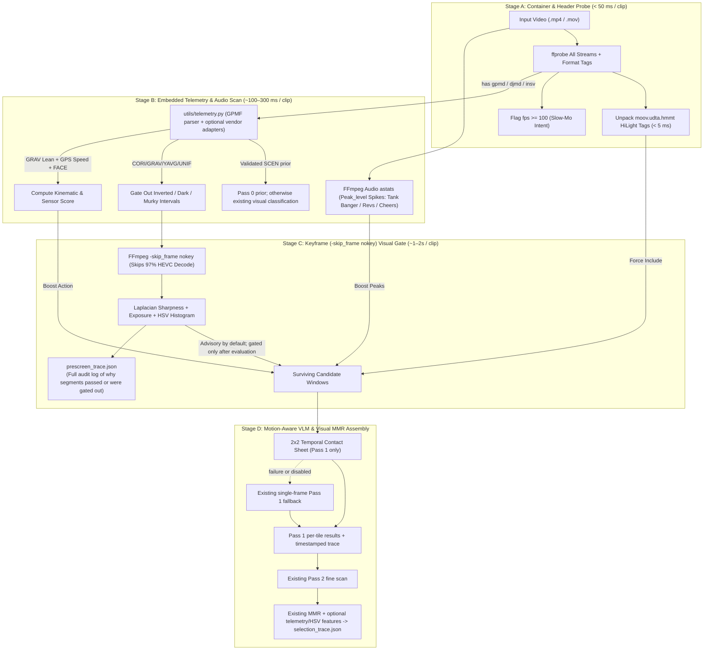

# Architecture Plan: [Issue #62] Action-camera sensor telemetry (GPMF/DJI/Insta360), container HiLights, and pre-VLM screening funnel

- **Issue**: [#62](https://github.com/tiwu/dive-clip-tui/issues/62)
- **Status**: Plan Review
- **Author**: Autonomous Agent / Contributor
- **Date**: 2026-11-03
- **Target Branch**: `feature/issue-62-telemetry-and-pre-vlm-screening-funnel`
- **Builds On**: [#61](https://github.com/tiwu/dive-clip-tui/issues/61), released in `0.27.0`; implementation baseline is `0.27.1`
- **Research Reference**: [`docs/research/highlight-detection-and-telemetry.md`](../research/highlight-detection-and-telemetry.md)

---

## 1. Problem Statement & Motivation

The work in #61 established Pass 0 usability and domain classification, MMR selection, stable detection identifiers, and per-stage decision traces. The `0.27.1` baseline also incrementally flushes stage traces. Existing coarse orientation/usability checks must remain intact. This plan adds embedded action-camera signals and programmatic pre-screening; it extends those contracts rather than replacing them.

1. **`00_ingest_media.py` Strips Telemetry & Audio Streams**:
   - `probe_video()` currently queries only `v:0`, so the manifest does not describe embedded timed metadata tracks (`gpmd` on GoPro HERO5+, `djmd` on DJI Action, trailer records on Insta360), audio streams, `creation_time`, bitrate density, or manual user `HiLight` tags (`moov.udta.hmmt`).
2. **Unused On-Chip Hardware CV & IMU Telemetry (`gpmd` / `djmd` / Insta360)**:
   - GoPro HERO7+ cameras run real-time hardware scene classification (`SCEN`: `WATR`, `VEGE`, `URB`, `INDO`, `SNOW`, `BEAC`), luma/uniformity analysis (`YAVG`, `UNIF`, `HUES`), face/smile detection (`FACE`), 200Hz IMU (`ACCL`, `GYRO`), quaternion orientation/gravity (`CORI`, `IORI`, `GRAV`), and GPS (`GPS5`/`GPS9`) during capture and store them in the MP4 container.
   - Pass 0 and coarse prompts already screen domains and unusable orientation visually. Some cameras also record useful time-indexed signals (at differing rates and not on every model); this plan tests whether those signals can reduce VLM work or improve ranking without overriding visual evidence.
3. **Brute-Force Decoding & Single-Frame Motion Blindness in Pass 1**:
   - Pass 1 samples static `0.25–0.5 FPS` frames and sends them to Ollama one by one. Programmatic signals and temporal contact sheets may reduce unnecessary inference, but must preserve candidate coverage and existing scan behavior.
   - Static single frames also deprive Qwen2.5-VL of temporal motion cues (smooth glide vs. erratic shake, progressive cornering lean vs. stationary stop) and ignore acoustic excitement spikes (underwater tank bangers/shakers, giant-stride splashes, motorcycle exhaust revs, cheering).

This plan introduces a multi-stage **Pre-VLM Telemetry & Programmatic Screening Funnel**. Additive optional manifest, detection, and trace fields preserve existing JSON consumers, so the proposed impact is `semver:minor`. Revisit this only if implementation requires a breaking contract change.

---

## 2. Requirements & Acceptance Criteria

### Functional Requirements

- [ ] **Stage A — All-Stream Container Header & MP4 `hmmt` HiLight Extraction (`scripts/00_ingest_media.py`, `utils/models.py`)**:
  - Expand `probe_video()` to inspect all container streams (`video`, `audio`, `data`/`meta` stream tags `gpmd`, `djmd`), `format.tags.creation_time`, `format.bit_rate`, and bits-per-pixel density.
  - Flag high-frame-rate recordings (`fps >= 100.0`, e.g., `120/240 FPS`) with `is_high_fps: bool = True` as a slow-motion/high-intent prior.
  - Parse MP4 `moov.udta.hmmt` (HiLight Marker Table) in pure Python (`struct.unpack`) to extract manual user HiLight timestamps (`hilight_tags: list[float]`) and promote `[t - 4.0, t + 4.0]` into candidate windows, clamped to clip duration. Treat timing claims as benchmark targets, not correctness assumptions.
- [ ] **Stage B — Action-Camera Sensor Telemetry Engine (`utils/telemetry.py`, `scripts/02_scan_footage.py`)**:
  - Implement `utils/telemetry.py` for GoPro GPMF (`gpmd` KLV stream), DJI (`djmd`), and Insta360 trailer telemetry. Scope initial decoding to validated fields and document unsupported camera/firmware combinations.
  - Keep third-party parsers optional until package API, license, and Python 3.14 compatibility are verified. If an adapter is unavailable or fails, log a warning and continue with the existing visual pipeline; do not make telemetry a required install or silently treat missing data as a negative signal.
  - **Pass 0 Telemetry Fast-Path**: Start with configurable candidate thresholds of `SCEN` domain confidence `>= 0.80` and matching-domain coverage `>= 0.80` of valid samples. A result may avoid Pass 0 VLM calls only after the domain mapping and camera coverage are validated; otherwise use existing visual classification. Dark/uniform signals may not mark an entire clip unusable without preserving visual sampling and the existing high-quality-frame override. Record telemetry provenance, confidence, coverage, thresholds, and fallback reason in `classifications.json`.
  - **Per-Timestamp Telemetry Gate & Kinematic Scoring**:
    - Start with configurable candidate thresholds: `YAVG < 15`, `UNIF > 0.92`, and `GYRO > 3.5 rad/s` RMS. Treat these as tunable defaults, not universal facts; validate units, sensor orientation, sampling coverage, and device-specific behavior before they can reject frames.
    - Record each gate's input values, threshold, outcome, and reason before filtering. Keep gates advisory until evaluation shows no regression on existing false-negative and positive-highlight cases; then allow only explicitly configured, evaluated gates to reject candidate samples.
    - Define a configurable initial `telemetry_score` (`0.0–1.0`) from normalized feature scores, with starting weights: lean/speed `0.35`, gyro stability `0.25`, face detections `0.20`, and hue changes `0.20`. Document and trace each feature's normalization range. Renormalize weights over available valid signals; missing sensors produce a missing score, never an implicit zero or penalty. Treat weights as tunable defaults, not learned or validated truth.
    - Keep telemetry/visual gates in trace-only advisory mode by default. Make contact sheets opt-in until per-tile coverage and quality are validated; preserve single-frame fallback.
- [ ] **Stage C — Keyframe (`-skip_frame nokey`) HSV Histogram + Blur Gate & Audio `astats` Spike Detection (`utils/ffmpeg_streamer.py`, `utils/prescreen.py`, `utils/selection.py`)**:
  - Evaluate keyframe-only extraction (`-skip_frame nokey`) as an optimization, not the sole sampling path: keyframes can miss brief events between I-frames. Compare coverage and decode cost against current extraction, and fall back to current sampling if keyframe extraction is unsupported or incomplete.
  - Compute per-frame **Laplacian blur variance**, exposure (`Y_mean`), and a compact HSV histogram vector. Name and validate the imaging dependency and Python 3.14 support before adding it; keep optional if practical.
  - Record gate inputs and decisions before filtering. Preserve existing sampling and high-quality-frame overrides until evaluation proves gates safe; avoid rejecting a whole clip based on a single bad frame.
  - Attach optional HSV features to `RefinedDetection` and extend the existing `select_diverse_highlights()` pairwise similarity/trace contract. Missing histograms must preserve current text-based MMR behavior.
  - Implement fast audio track spike detection (`ffmpeg -vn -af astats=metadata=1:reset=1`) to detect sudden `Peak_level` surges (>10 dB above rolling median: underwater tank-banger/shaker signals, giant-stride splashes, motorcycle exhaust revs, laughter/cheering) without penalizing quiet underwater macro hovering.
- [ ] **Stage D — `2x2` Temporal Contact Sheets for Pass 1 VLM Screening (`utils/ffmpeg_streamer.py`, `scripts/02_scan_footage.py`)**:
  - Limit contact sheets to Pass 1. Define the response contract before implementation: each sheet contains up to four ordered samples; each tile has a stable tile index and source timestamp; model results map back to those tile timestamps and existing per-frame trace fields.
  - Retain per-tile `detected`, score, rejection, and subject results rather than treating one sheet response as a single frame. Test timestamp mapping for short clips and partial sheets.
  - Fall back to the existing single-frame Pass 1 path when sheet extraction fails, the model cannot return valid per-tile results, or the feature is disabled. Measure actual call reduction and detection coverage; treat “up to 4x” as a target, not a guarantee.
- [ ] **Per-Stage Pre-VLM Traceability Artifact (`prescreen_trace.json`)**:
  - Persist `<run_dir>/prescreen_trace.json` with one record per clip and each candidate timestamp/window evaluated by the funnel, not one record per raw telemetry sample. Include aggregation interval/sample count so sensor evidence remains auditable without 200 Hz trace growth.
  - Include container signals (`is_high_fps`, `hilight_tags`, `bitrate_density`, `telemetry_type`); telemetry signals (`scen_dominant`, `yavg`, `unif`, `roll_deg`, `pitch_deg`, `gyro_rms`, `gps_speed_ms`, `face_detected`); audio/visual signals (`audio_peak_db`, `audio_spike_triggered`, `laplacian_sharpness`, `hsv_entropy`); and configured thresholds, gate outcomes/reasons, score components/weights, chosen action, and whether a VLM call followed.
  - Flush trace records incrementally and atomically by clip, using the existing run artifact conventions and `0.27.1` incremental trace behavior. Tests must prove interrupted runs retain completed decisions and resume does not duplicate records.
  - Extend `pass1_coarse_trace.json` and `selection_trace.json` with optional telemetry/HSV score breakdowns while preserving current fields and behavior for old artifacts and detections without sensor data.
- [ ] **Explicit Documentation & Configuration Updates**:
  - **`config.yaml`**: Add telemetry, keyframe pre-screening, audio spike threshold, `2x2` contact sheet, advisory/enabled gate mode, feature weights, and contact-sheet opt-in settings.
  - **`README.md`**: Document GoPro GPMF / DJI / Insta360 telemetry integration, `hmmt` HiLight support, the 4-stage pre-VLM filter funnel, and `prescreen_trace.json` inspection.
  - **`AGENTS.md`**: Update repository architecture (`utils/telemetry.py`, `utils/prescreen.py`) and document optional dependency and fallback behavior.
  - **`docs/roadmap/roadmap.md`**: Add this work in the appropriate priority without duplicating shipped work. Reconcile milestones already delivered by `0.27.1`, including standalone Pass 0, render-race safety, MMR, and traceability.
  - **`CHANGELOG.md`**: Add user-facing entry under `[Unreleased]`.

---

## 3. Architecture & Data Flow

---

## 4. Change Log and Release Impact

- **Change category**: Added
- **Proposed SemVer impact**: `semver:minor`
- Add new JSON fields as optional with defaults; keep old manifests, detections, and run artifacts readable. Reassess the bump only if a breaking change becomes necessary.
- **Draft changelog entry**: Add optional action-camera telemetry parsing (GoPro GPMF `gpmd`, DJI `djmd`, Insta360), manual MP4 `hmmt` HiLight tags, configurable pre-screen signals, audio `astats` peak detection, opt-in Pass 1 temporal contact sheets, and auditable `prescreen_trace.json` decisions.

---

## 5. Test-Driven Development (TDD) Plan

1. **Red (Tests First)**:
   - `tests/test_ingest_media.py`:
     - Test all-stream `ffprobe` parsing (`has_telemetry`, `telemetry_type`, `creation_time`, `is_high_fps` for 120/240fps, `has_audio`), plus missing/unsupported streams and backward-compatible manifest loading.
     - Test binary MP4 `moov.udta.hmmt` parser extracting millisecond HiLight markers into seconds.
   - `tests/test_telemetry.py`:
     - Test GoPro GPMF binary KLV parser and any selected optional adapter on synthetic `SCEN` (`WATR`), `YAVG`, `UNIF`, `CORI`/`GRAV` (upright vs. inverted vs. leaning motorcycle), `GYRO` (smooth pan vs. chaotic shake), `GPS5` speed, and `FACE` payloads.
     - Test the configured `SCEN` confidence/coverage rule, visual fallback on absent or uncertain telemetry, and preservation of the existing high-quality-frame override.
   - `tests/test_prescreen.py`:
     - Test Laplacian blur variance and brightness gates, threshold and reason capture before filtering, and that disabled/advisory gates preserve existing candidate coverage.
     - Test HSV histogram similarity, missing-histogram compatibility, and its score breakdown in `select_diverse_highlights()`.
     - Test FFmpeg `astats` output parser identifying `Peak_level` spikes (>10 dB over rolling median) while ignoring steady low RMS underwater audio.
   - `tests/test_ffmpeg_streamer.py`:
     - Test keyframe extraction fallback and `tile=2x2` ordering, partial sheets, per-tile timestamp mapping, invalid response fallback, and preserved Pass 2 behavior.
   - Test trace size is bounded by evaluated windows, incremental atomic flush, resume idempotence, and retention of completed trace records after interruption.
2. **Green (Implementation)**:
   - Update `utils/models.py` (`ClipManifest`, `RefinedDetection`, and `PrescreenTrace` schemas).
   - Implement `moov.udta.hmmt` and all-stream probing in `scripts/00_ingest_media.py`.
   - Verify candidate parser and image-processing dependencies, licenses, and Python 3.14 support before selection; keep optional adapters optional and change dependency manifests only for the selected, validated packages. Implement `utils/telemetry.py` with graceful visual fallback and `utils/prescreen.py` with configurable starting weights, advisory gate defaults, audited decisions, and bounded incremental `prescreen_trace.json` output.
   - Integrate the pre-VLM funnel and `2x2` contact sheets into `scripts/02_scan_footage.py` and `utils/ffmpeg_streamer.py`.
   - Update `config.yaml`, `README.md`, `AGENTS.md`, `docs/roadmap/roadmap.md`, and `CHANGELOG.md`.
3. **Refactor & Quality**:
   - Run focused test suite, then full test suite (`uv run python -m pytest`).
   - Run Ruff lint and format checks (`uv run ruff check .` and `uv run ruff format --check .`).

---

## 6. Verification & Rollout Checklist

- [ ] Tests pass: `uv run python -m pytest`
- [ ] Changed Python files pass Ruff lint and formatting checks
- [ ] `prescreen_trace.json` and enriched `classifications.json` / `selection_trace.json` verified in run directory
- [ ] Documentation updated (`config.yaml`, `README.md`, `AGENTS.md`, `docs/roadmap/roadmap.md`, `CHANGELOG.md`)
- [ ] PR labeled with `semver:minor` (reassess only if a documented breaking contract is introduced)
- [ ] PR submitted with `Closes #62` and plan linked
