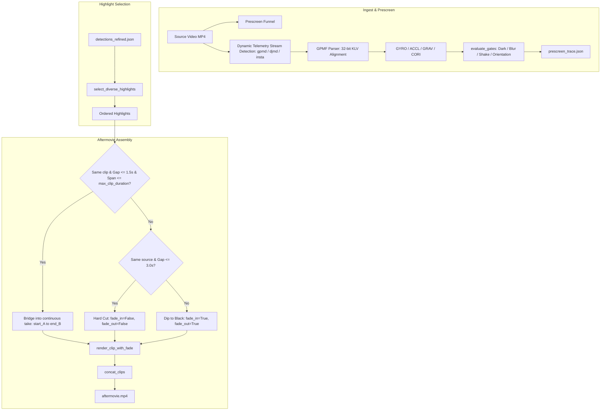

# Architecture Plan: [Issue #71] feat: smart aftermovie transitions, camera-agnostic telemetry stream detection, and orientation gate

- **Issue**: [#71](https://github.com/tiwu/dive-clip-tui/issues/71)
- **Status**: Plan Review
- **Author**: Antigravity
- **Date**: 2026-11-04
- **Target Branch**: `feature/issue-71-smart-transitions-gopro-telemetry-and-orientation-gate`

---

## 1. Problem Statement & Motivation

Following analysis of runs `run-20261104-144615` and `run-20261104-151002`, two interrelated pipeline issues were identified:

### 1. Jarring Dip-to-Black Transitions Between Continuous Footage
In `scripts/07_create_aftermovie.py`, every single highlight clip is unconditionally rendered with a 1.0-second fade-in from black and a 1.0-second fade-out to black:
```python
vf_filters.append(f"fade=t=in:st=0:d={fade}")
vf_filters.append(f"fade=t=out:st={duration - fade}:d={fade}")
```
When multiple highlights are chosen from the same source video (e.g. 3 highlights of the Moray Eel in `GX010777-eel.MP4` or 3 highlights in `GX010881-horse.MP4`), they sort chronologically back-to-back.
In multiple instances, adjacent clips are separated by only **0.5 seconds** (e.g. `27.5s–31.0s` and `31.5s–35.0s`).
The viewer experiences a 2-second dip to black and back in the middle of a continuous scene, which looks like a jarring rendering glitch rather than a cinematic edit.

### 2. Stream Mapping Bug, GPMF Alignment & Missing Orientation Gate
In `run-20261104-151002`, prescreen ran in advisory mode. While it correctly caught blurry distant footage (`GX010830-turtle-far.MP4`, Laplacian 8.85 vs floor 12.0), a dangling/upside-down camera clip (`GX010875-bad.MP4`) was not flagged.
Investigation revealed:
1. **Hardcoded Stream Index (`0:d:0`)**: `extract_telemetry_bytes()` hardcoded `ffmpeg -map 0:d:0`. MP4 containers from modern action cameras often contain multiple data streams. For example, GoPro files contain two data streams:
   - `0:d:0` is `tmcd` (timecode) — exactly 4 bytes!
   - `0:d:1` is `gpmd` (GoPro Metadata) — 150+ KB of telemetry.
   Because `0:d:0` was blindly assumed, `load_telemetry()` received 4 timecode bytes, found 0 sensor packets, and silently reported `signal unavailable` (`gyro_rms: null`). Rather than hardcoding for GoPro, the system should dynamically probe and detect which stream carries telemetry across any action-camera format (GoPro `gpmd`, DJI `djmd`, Insta360 `insta`).
2. **GPMF 32-bit KLV Alignment Bug**: Per the GPMF specification, all KLV payloads are 32-bit aligned (`(payload_length + 3) & ~3`). In `_iter_klv()`, the parser advanced unaligned `position = payload_end`. When encountering an odd-length string (such as `STNM: "Gyroscope"`, 9 bytes), the parser became unaligned, read invalid lengths, and aborted parsing.
3. **Missing Orientation Gate**: `evaluate_gates()` in `utils/telemetry.py` only evaluated `dark`, `featureless`, and `shake`. It lacked an `orientation` / `upside_down` check against gravity (`GRAV`) or pitch/roll (`CORI`), leaving inverted camera footage unflagged.

When the real `gpmd` stream was parsed with proper 32-bit alignment:
- Steady diver footage: Gyro RMS = **270**, Gravity Z = **+19,179** (upright).
- Dangling bad clip: Gyro RMS = **1,039** (~4x more violent shake) and Gravity Z = **-27,455** (strongly inverted / upside down).

---

## 2. Requirements & Acceptance Criteria

### Smart Transitions & Gap Bridging
- [ ] **Configurable Transition Parameters & Scope**:
  - Add `min_transition_gap: 3.0` and `bridge_gap_seconds: 1.5` under `aftermovie:` in `config.yaml`.
  - Resolve `max_clip_duration` in `07_create_aftermovie.py` with hierarchical fallback:
    ```python
    max_clip_duration = float(
        aftermovie_cfg.get(
            "max_clip_duration",
            scan_params.get("max_clip_duration", 12.0)
        )
    )
    ```
- [ ] **Merged-Span Gap Bridging**:
  - For consecutive highlights A (`start_time_A`, `end_time_A`) and B (`start_time_B`, `end_time_B`):
    - `gap = start_time_B - end_time_A`
    - `merged_start = start_time_A`
    - `merged_end = end_time_B`
    - `merged_duration = merged_end - merged_start`
  - When `source_file_A == source_file_B`, `0.0 <= gap <= bridge_gap_seconds` (1.5s), and `merged_duration <= max_clip_duration` (12.0s), merge A and B into a single continuous window `[merged_start, merged_end]`.
  - If `merged_duration > max_clip_duration`, do not bridge; keep them as separate clips and apply the straight-cut transition.
- [ ] **Context-Aware Fade Logic**:
  - In `render_clip_with_fade()`: support independent `fade_in: bool = True` and `fade_out: bool = True` flags.
  - Dip to black (`fade_out = True`, `fade_in = True`) only when transitioning between **different source files** or across **large time jumps** (`gap > min_transition_gap`).
  - Use clean **straight cuts** (`fade_out = False`, `fade_in = False`) between consecutive highlights from the same source file with gaps `<= min_transition_gap`.
  - The first clip of the aftermovie always opens with `fade_in = True`; the final clip always closes with `fade_out = True`.

### Camera-Agnostic Telemetry Stream Detection & GPMF Alignment
- [ ] **Dynamic Stream Detection**:
  - Implement camera-agnostic stream detection in `utils/telemetry.py` that inspects container streams with `ffprobe` (or uses manifest metadata) to locate the stream carrying telemetry based on known tags (`gpmd`, `djmd`, `insta`) and handlers (`GoPro MET`, `DJI.Meta`).
  - `extract_telemetry_bytes()` maps the discovered stream index (`-map 0:<stream_index>`) rather than assuming `0:d:0`.
  - `00_ingest_media.py` stores `telemetry_stream_index` in `manifest.json` alongside `telemetry_type`.
- [ ] **32-Bit Alignment in GPMF Parser**:
  - `_iter_klv()` in `utils/telemetry.py` must align payload position advancement to 4 bytes: `(payload_length + 3) & ~3`.
  - Validate that `GYRO`, `ACCL`, `CORI`, `GRAV`, `FACE`, `SCEN`, and `HUES` decode completely from GoPro HERO12 footage.

### Orientation / Upside-down Gating & Math Specification
- [ ] **Verified Unit Conversions for GRAV and CORI**:
  - **`GRAV` (Gravity Vector)**:
    - GPMF payload: 3-axis signed 16-bit integers `[X, Y, Z]` with `SCAL = 32767`.
    - Normalized gravity unit vector: `(gx, gy, gz) = (X / 32767.0, Y / 32767.0, Z / 32767.0)`.
    - In the GoPro coordinate frame, `+Y` points to the bottom of the camera body (downward when level).
    - Tilt angle formula:
      ```python
      tilt_deg = math.acos(max(-1.0, min(1.0, gy))) * (180.0 / math.pi)
      ```
      - Upright level camera: `gy = 1.0` -> `tilt = 0.0°`.
      - Normal reef dive pitch (diver angled down): `gy ≈ 0.81` -> `tilt ≈ 36.0°`.
      - Inverted / dangling camera: `gy < 0` -> `tilt > 90.0°` (on `GX010875-bad.MP4`, `gy = -0.33` -> `tilt = 109.5°`).
  - **`CORI` (Camera Orientation Quaternions)**:
    - GPMF payload: 4-axis signed 16-bit integers `[W, X, Y, Z]` with `SCAL = 32767`.
    - Unit quaternion: `[qw, qx, qy, qz] = [W, X, Y, Z] / 32767.0`.
    - Roll and pitch conversions:
      ```python
      roll_deg = math.atan2(2 * (qw * qx + qy * qz), 1 - 2 * (qx**2 + qy**2)) * (180.0 / math.pi)
      pitch_deg = math.asin(max(-1.0, min(1.0, 2 * (qw * qy - qz * qx)))) * (180.0 / math.pi)
      ```
- [ ] **Orientation Gate in `evaluate_gates()`**:
  - Add an `orientation` gate evaluating `tilt_deg` (using `GRAV`, falling back to `CORI` `|pitch|` / `|roll|`).
  - Threshold `tilt_max` defaults to `100.0` degrees under `prescreen:`.
  - When `tilt_deg > tilt_max`, mark gate as `outcome: fail`. In `enabled` mode, prescreen rejects/defers the window.
- [ ] **Shake Gate Verification**:
  - With `GYRO` decoding operational (GPMF scale `SCAL` for `rad/s`), verify that high RMS shake (`gyro_rms > gyro_max`, default: `3.5`) triggers the `shake` gate on swinging/banging camera clips.

### Documentation & Permanent Telemetry References
- [ ] **Repository Documentation & Codebase References**:
  - Update `README.md` with a dedicated section detailing action-camera telemetry tracks, the GPMF 32-bit KLV alignment rule, FourCC sensor tags, camera body coordinate axes, and primary reference links.
  - Update `utils/telemetry.py` module and helper docstrings with full citations and links to the GoPro GPMF Parser specification and `docs/research/highlight-detection-and-telemetry.md`.

---

## 3. Change Log and Release Impact

- **Change category**: Added / Fixed
- **Proposed SemVer impact**: `semver:minor`
- **Draft changelog entry**:
  - `Added`: Smart aftermovie transitions that use clean hard cuts and optional gap bridging between consecutive highlights from the same source clip, reserving dip-to-black fades for scene changes and large time jumps.
  - `Added`: Camera orientation / upside-down prescreen gate to identify and reject dangling or inverted camera footage using calibrated gravity vector and orientation telemetry.
  - `Fixed`: Action camera telemetry stream detection to dynamically locate telemetry data streams (GoPro `gpmd`, DJI `djmd`, Insta360 `insta`) instead of assuming index 0, and fixed 32-bit KLV byte alignment in GPMF decoding.
  - `Documentation`: Added action-camera telemetry format specifications, GPMF structure rules, and coordinate axis references to `README.md` and `utils/telemetry.py`.

---

## 4. Architectural Design & Implementation Details



### Module Boundaries & Seams
1. `utils/telemetry.py`:
   - Module docstring: full GPMF specification citations, coordinate system conventions, and MP4 container layout rules.
   - `detect_telemetry_stream(video_path: Path) -> tuple[str, int] | None`: probes container streams using `ffprobe` to match `TELEMETRY_STREAM_TAGS` (`gpmd`, `djmd`, `insta`) or handler tags, returning `(telemetry_type, stream_index)`.
   - `extract_telemetry_bytes(video_path: Path, stream_index: int | None = None, ...)`: maps `-map 0:<stream_index>`.
   - `_iter_klv(data, ...)`: steps by `(payload_length + 3) & ~3`.
   - `_decode_grav(payload, scal)`: converts int16 triples to normalized unit gravity vector and derives `tilt_deg = math.acos(max(-1.0, min(1.0, gy))) * (180.0 / math.pi)`.
   - `evaluate_gates(signals, ...)`: adds `orientation` gate evaluating `tilt_deg` against `tilt_max`.
2. `scripts/00_ingest_media.py`:
   - Ingests `telemetry_stream_index` into `manifest.json`.
3. `utils/prescreen.py`:
   - Propagates `orientation` gate configuration and records `tilt_deg` and `orientation` gate outcome in `prescreen_trace.json`.
4. `scripts/07_create_aftermovie.py`:
   - Resolves `max_clip_duration` from `aftermovie:` config falling back to `scan_parameters.max_clip_duration` (default: 12.0s).
   - Implements gap bridging for adjacent windows from the same source file when `merged_duration <= max_clip_duration`.
   - Computes contextual `fade_in` and `fade_out` flags per clip based on source file continuity and temporal proximity.
   - Passes `fade_in` and `fade_out` to `render_clip_with_fade()`.
5. `config.yaml`:
   - Adds `min_transition_gap: 3.0` and `bridge_gap_seconds: 1.5` under `aftermovie:`.
   - Adds `tilt_max: 100.0` under `prescreen:`.
6. `README.md`:
   - Adds telemetry format specifications, GPMF structure rules, coordinate system definitions, and primary reference links.

---

## 5. Test-Driven Development (TDD) Plan

1. **Red (Tests First)**:
   - `tests/test_aftermovie.py`:
     - Test `render_clip_with_fade()` with `fade_in=False`, `fade_out=False`, and mixed combinations.
     - Test boundary decision logic: same source + gap `<= 3.0s` -> straight cut; different source -> dip to black; start and end clips -> fade in/out.
     - Test gap bridging: two detections from same source separated by `0.5s` with `merged_duration <= max_clip_duration` bridged into one continuous window; verify that exceeding `max_clip_duration` keeps them separate with straight cuts.
   - `tests/test_telemetry.py`:
     - Test `detect_telemetry_stream()` on mock streams for GoPro (`gpmd` at stream index 3 with `tmcd` at index 2), DJI (`djmd` at stream index 2), and Insta360 (`insta` at stream index 1).
     - Test `_iter_klv()` with odd-length payloads ensuring 4-byte aligned continuation.
     - Test `_decode_grav()` converting raw int16 values to normalized gravity vector and verified `tilt_deg`.
     - Test `evaluate_gates()` with `tilt_deg` triggering `orientation` gate.
     - Test `evaluate_gates()` with `gyro_rms` triggering `shake` gate.
2. **Green (Implementation)**:
   - Implement camera-agnostic telemetry stream detection and 4-byte KLV alignment in `utils/telemetry.py`.
   - Add `telemetry_stream_index` extraction in `scripts/00_ingest_media.py`.
   - Add `orientation` gate and `tilt_deg` computation to `utils/telemetry.py` and `utils/prescreen.py`.
   - Implement smart transitions and gap bridging in `scripts/07_create_aftermovie.py`.
   - Update `config.yaml`, `README.md`, and module docstrings.
3. **Refactor & Quality**:
   - Run focused pytest suites: `uv run python -m pytest tests/test_telemetry.py tests/test_aftermovie.py tests/test_prescreen.py`.
   - Run full test suite: `uv run python -m pytest`.
   - Run Ruff linting and formatting: `uv run ruff check .` and `uv run ruff format --check .`.

---

## 6. Verification & Rollout Checklist

- [ ] Tests pass: `uv run python -m pytest`
- [ ] Changed Python files pass Ruff lint and formatting checks
- [ ] `CHANGELOG.md` updated under `[Unreleased]`
- [ ] Documentation updated in `README.md` and `utils/telemetry.py`
- [ ] Real GoPro Hero 12 clip verification: `GX010875-bad.MP4` and `GX010777-eel.MP4` telemetry properly decoded and `GX010875-bad.MP4` triggers orientation/shake gate
- [ ] PR labeled with `semver:minor`
- [ ] PR submitted with `Closes #71` and plan linked

---

## 7. Reference Specifications & Documentation

The following primary sources define the action-camera telemetry data formats and container layouts referenced in this plan:

### GoPro GPMF (General Purpose Metadata Format)
- **Official Specification & Parser Repository**: [GoPro GPMF Parser (GitHub)](https://github.com/gopro/gpmf-parser)
- **Structure & 32-bit KLV Alignment**: [GPMF Structure Documentation](https://github.com/gopro/gpmf-parser#gpmf-structure)
  > *"All data within GPMF is 32-bit aligned. Payloads that do not naturally end on a 32-bit boundary are padded with zeros to maintain alignment. The size field in the KLV header describes the unpadded payload size, while parsers must step forward by the 32-bit padded length: `(payload_length + 3) & ~3`."*
- **Common Tags & Types**: [GPMF Tag Reference](https://github.com/gopro/gpmf-parser#common-tags)
  - Containers: `DEVC` (Device container), `STRM` (Stream container), `DVID` (Device ID).
  - Stream metadata: `STMP` (Microsecond timestamp), `TSMP` (Total samples), `STNM` (Stream name string), `SCAL` (Scaling factor divider), `SIUN` (SI units string), `TYPE` (Type definitions).
  - Motion sensors:
    - `ACCL`: 3-axis accelerometer (m/s² after `SCAL` division).
    - `GYRO`: 3-axis gyroscope rate (rad/s after `SCAL` division).
    - `GRAV`: 3-axis gravity acceleration unit vector `[gx, gy, gz]` scaled by `SCAL = 32767`.
    - `CORI`: Camera orientation quaternions `[qw, qx, qy, qz]` scaled by `SCAL = 32767`.
    - `IORI`: Image orientation relative to body.
- **GoPro Camera Body Axes**:
  - `+X`: Camera right (facing forward with lens).
  - `+Y`: Camera bottom (downward along the camera casing).
  - `+Z`: Forward along the optical axis (out through the lens).
  - When upright and level: Gravity `g = [0, +1, 0]` (pointing towards camera bottom). Inversion occurs when `gy < 0`.

### In-Repository Technical Documentation
- **Telemetry & Highlight Detection Deep Dive**: [`docs/research/highlight-detection-and-telemetry.md`](docs/research/highlight-detection-and-telemetry.md) — Comprehensive primary-source research covering GoPro GPMF, DJI `djmd` protobuf streams, Insta360 trailer metadata, and signal fusion architectures.

### MP4 Container Stream Identification
- **GoPro**: FourCC `gpmd` (handler name `GoPro MET` / `GoPro METADATA`) vs timecode `tmcd` (handler `GoPro TCD`).
- **DJI**: FourCC `djmd` (handler name `DJI.Meta`), protobuf payload.
- **Insta360**: FourCC `insta` (trailer or auxiliary track).
