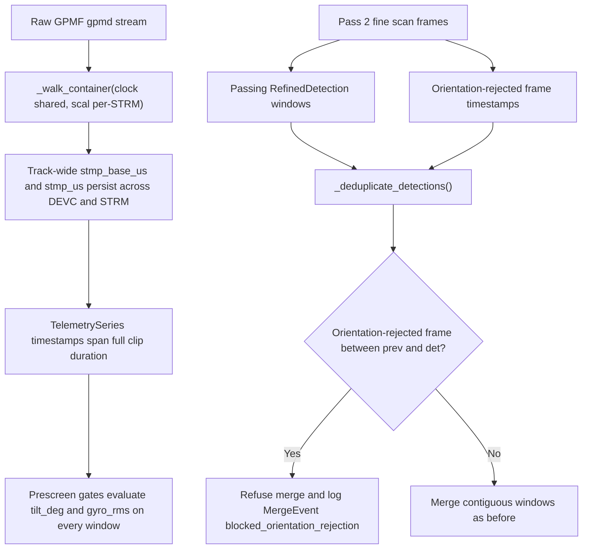

# Architecture Plan: [Issue #84] Fix GoPro GPMF STMP timestamp persistence and prevent Pass 2 merging across inverted frames

- **Issue**: [#84](https://github.com/tiwu/dive-clip-tui/issues/84)
- **Status**: In Progress
- **Author**: Autonomous Agent / Contributor
- **Date**: 2026-11-20
- **Target Branch**: `feature/issue-84-fix-gpmf-stmp-and-orientation-merge`

---

## 1. Problem Statement & Motivation

During inspection of `run-20261119-155336` (111 GoPro 4K clips, ~3.2 hours of dive footage), an upside-down segment of `GX010832.MP4` (`269.5–278.0s`, mislabeled `"diver exploring underwater cave"`) passed both the pre-VLM orientation gate and Pass 2 fine scan into `detections_refined.json`.

Forensic analysis of `prescreen_trace.json`, `pass2_fine_trace.json`, and raw `gpmd` packets from `GX010832.MP4` uncovered two stacked bugs:

1. **GPMF `STMP` clock state reset across nested containers (`utils/telemetry.py:281-296`):**
   - `_walk_container()` copies `stream_state = dict(state)` before recursing into every `DEVC` and `STRM` container (`stream_state = dict(state)`).
   - In real GoPro `gpmd` streams, `STMP` microsecond clock records live **inside** each `DEVC -> STRM` container (unlike the synthetic test fixture in `tests/test_telemetry.py`, which places `STMP` at top level outside `DEVC`).
   - Because `stream_state` is discarded when recursion returns, `state["stmp_base_us"]` and `state["stmp_us"]` stay `None` across containers. Every `STRM` sets `stmp_base_us = stmp_us` from its own single `STMP` and computes `(stmp_us - stmp_base_us) = 0.0s`.
   - **Impact on `run-20261119-155336`:** Across all 111 clips (1,453 prescreen windows), **only window 0 (`[0.0, 8.0s]`) of each file received telemetry (`111 / 1,453` windows)**; all 1,342 later windows had `sample_count = 0`, `tilt_deg = None`, and `gyro_rms = None`.
   - On `GX010832.MP4` (545.8s, 546 `DEVC` blocks), all 958,637 telemetry samples piled into `[0.0, 8.0s]` (`tilt_deg = 158.5°`), while `264.0–284.0s` had `tilt_deg = None` and silently passed `evaluate_gates()`. Re-parsing `GX010832.MP4` with persistent `STMP` clock shows `tilt_deg = 142.0°–165.9°` across `264–284s` and **`512 / 545` seconds exceeding `100.0°`**, meaning the orientation gate would have rejected the inverted footage before making any VLM calls.

2. **Pass 2 shot merging bridges across rejected upside-down frames (`scripts/02_scan_footage.py:2335-2455`):**
   - Even without telemetry, Pass 2 VLM evaluation of `GX010832.MP4` explicitly rejected frames inside the segment:
     - `t=271.5s`: `passed_gate=False`, `reject_reasons=['...', 'camera angle is tilted and unbalanced', ...]`
     - `t=272.5s`: `passed_gate=False`, `reject_reasons=['No diver visible in frame', 'Frame is upside down (inverted perspective)', ...]`
     - `t=277.5s`, `280.5s`, `282.5s`: rejected as tilted / upside down.
   - However, `_deduplicate_detections()` only receives passing `RefinedDetection` objects (`all_detections`). Because `t=269.5s` (`[268.0, 271.5s]`, misread as `"diver exploring underwater cave"`) and `t=274.5s` (`[273.0, 276.5s]`) lay within `merge_gap_seconds = 1.5s`, `_deduplicate_detections()` merged right across the rejected inverted frames into a single `8.5s` detection (`[269.5, 278.0s]` after adjacent merges).

---

## 2. Architecture & Locked Technical Contracts

### 2.1 Track-Wide GPMF Clock Persistence & `SCAL` Isolation (`utils/telemetry.py`)

Update `_walk_container()` and `parse_gpmf()` so clock state persists across the entire track while scaling factors remain strictly `STRM`-scoped:

1. **Separated state contract:**
   - Replace the single copied `state` dict with:
     - `clock: dict[str, float | None]` (shared mutable reference across recursive `DEVC`/`DVID`/`STRM` calls), holding:
       - `stmp_base_us: float | None` — initialized once from the very first `STMP` record encountered in the track (handles both chapter 1 starting near `0` and GoPro chapter 2+ starting at e.g. `768_000_000 us`).
       - `stmp_us: float | None` — updated whenever any `STMP` record is encountered anywhere in the payload (top-level or nested inside `DEVC -> STRM`).
     - `scal: list[float] | None` — passed as a local parameter/per-`STRM` state reset to `None` on entering every `STRM` container so an `ACCL` `SCAL` never leaks into `GYRO` or sibling streams.
2. **Timestamp fallback for legacy `STMP`-less multi-`DEVC` tracks:**
   - If a payload contains multiple top-level `DEVC` containers, `0` `STMP` records were seen, and `duration > 0.0`, fall back to attributing samples in `DEVC` index `i` (of `N` total `DEVC` blocks) to `(i / N) * duration` instead of collapsing the entire track to `0.0s`.
3. **Preserved behavior:**
   - Existing payloads with top-level `STMP` before `DEVC` (such as `tests/test_telemetry.py`) behave identically.
   - `parse_gpmf()` provenance and return types remain unchanged.
4. **Documentation update (`utils/telemetry.py` docstring & `README.md`):**
   - Cite the GoPro GPMF container clock layout (`DEVC -> STRM -> STMP` track-wide clock vs per-`STRM` `SCAL` isolation) per repository telemetry documentation rules.

### 2.2 Pass 2 Orientation-Rejection Merge Barrier (`scripts/02_scan_footage.py`)

1. **Helper `_is_orientation_rejection(reject_reasons: Sequence[str]) -> bool`:**
   - Returns `True` if any entry in `reject_reasons` contains (case-insensitive) one of:
     `("upside down", "inverted", "tilted", "dangling", "sideways", "orientation")`.
2. **Collecting rejected orientation timestamps in `process_clip()`:**
   - From `pass2_frame_traces`, collect sorted timestamps `[trace.start_time for trace in pass2_frame_traces if not trace.passed_gate and _is_orientation_rejection(trace.reject_reasons)]` (representing the actual sampled frame timestamps when Pass 2 rejects a frame for orientation/inversion; note in `FineFrameTrace`, `start_time` stores the clipped window start `max(0.0, ts - pre_roll)` or let's store/compute the exact frame timestamp `ts` — wait: `FineFrameTrace` has `start_time = start_sec` and `end_time = end_sec`, while the sampled frame timestamp `ts` lies at `round(start_sec + pre_roll)` or we can collect the exact `ts` directly in the loop into `orientation_reject_timestamps: list[float]`).
   - Collecting exact sampled `ts` directly during the Pass 2 frame loop (`orientation_reject_timestamps.append(ts)`) avoids relying on `start_time`/`end_time` padding math!
3. **Barrier check inside `_deduplicate_detections()`:**
   - Add optional parameter `rejected_orientation_timestamps: Sequence[float] | None = None` (default `None` so all existing callers and unit tests keep working untouched).
   - When `is_adjacent and subjects_match` hold for candidate pair `(prev, det)`, check whether any `t` in `rejected_orientation_timestamps` lies between the two segments' core action intervals (`prev_core_end <= t <= det_core_start`, or practically `prev.start_time < t < det.end_time` where `t` fell in the gap/overlap between `prev` and `det` — specifically checking `any(prev_mid < t < det_mid for t in rejected_orientation_timestamps)` where `mid = (start + end) / 2.0`, OR `prev.end_time - fine_post_roll <= t <= det.start_time + fine_pre_roll`). Using `prev_mid < t < det_mid` (or `prev.start_time < t < det.end_time` when checking strictly between their anchor centers `prev_center <= t <= det_center`) guarantees that any rejected inverted frame between two passing frame centers blocks merging across that inverted span without blocking an unrelated window elsewhere in the clip!
   - Wait: let's verify against `GX010832.MP4`:
     - Passing frame `t1 = 269.5` -> `start_time = 268.0`, `end_time = 271.5` (wait: in `detections_refined.json`, merged window started at `269.5` because `fine_pre_roll_seconds = 1.5` around `271.0`? No, wait: `t1 = 269.5` had `start_sec = 268.0` or `269.5`? Wait: in step 72 `t=269.5s` in `FineFrameTrace` was `start_time`! So the raw frame timestamp was `ts = 271.0`, `start_time = 269.5`, `end_time = 273.0`; next passing frame `FineFrameTrace.start_time = 274.5` had `ts = 276.0`, `start_time = 274.5`, `end_time = 278.0`; and the rejected frames had `FineFrameTrace.start_time = 271.5` (`ts = 273.0`) and `272.5` (`ts = 274.0`)).
     - Notice `(269.5 + 273.0)/2 = 271.25` and `(274.5 + 278.0)/2 = 276.25`, while rejected `ts = 273.0` and `274.0` sit squarely between `[prev.start_time, det.end_time]` (`269.5 < 273.0 < 278.0`) AND between the two detections' midpoints (`271.25 < 273.0 < 276.25`) AND inside `[prev.start_time, det.start_time + pre_roll]`! Checking `prev_center <= t <= det_center` (where `center = (d.start_time + d.end_time) / 2.0`) works cleanly even after `prev` has already absorbed earlier segments!
   - When blocked, do **not** merge `prev` and `det`; append `det` as a new separate segment in `merged_group`, and if `trace_merge_events is not None`, append a `MergeEvent(..., action="blocked_orientation_rejection")`.

---

## 3. Requirements & Acceptance Criteria

- [x] **Track-wide GPMF `STMP` clock (`utils/telemetry.py`)**:
  - `STMP` timestamps inside nested `DEVC -> STRM` containers update a track-wide shared clock so `TelemetrySeries.timestamps` span the clip duration instead of resetting to `0.0s` on every block.
  - `SCAL` factors remain isolated per `STRM` container and never bleed across sibling streams.
  - Multi-`DEVC` GPMF payloads without `STMP` fall back to even interpolation across `duration` when `duration > 0`.
  - Existing top-level `STMP` parsing behavior remains unchanged.
  - `aggregate_window()` populates `tilt_deg`, `gyro_rms`, `yavg`, `unif`, and `sample_count` across every window of real multi-block GoPro footage (not only window `[0, 8.0s]`).
- [x] **Pass 2 orientation-rejection merge guard (`scripts/02_scan_footage.py`)**:
  - `_deduplicate_detections()` accepts optional `rejected_orientation_timestamps` and refuses to merge two adjacent matching detections when an orientation-rejected frame timestamp lies between their centers.
  - Emits `MergeEvent(..., action="blocked_orientation_rejection")` into `pass2_fine_trace.json` when a merge is blocked.
  - `process_clip()` records Pass 2 orientation-rejected frame timestamps (matching `"upside down"`, `"inverted"`, `"tilted"`, `"dangling"`, `"sideways"`, `"orientation"`) and passes them to `_deduplicate_detections()`.
- [x] **Tests & documentation**:
  - Focused unit tests in `tests/test_telemetry.py` and `tests/test_scan_footage.py` verify all new behaviors.
  - `utils/telemetry.py` docstring and `README.md` document GoPro `DEVC -> STRM -> STMP` clock scoping.
  - `CHANGELOG.md` updated under `[Unreleased]` (`Fixed`).

---

## 4. Change Log and Release Impact

- **Change category**: `Fixed`
- **Proposed SemVer impact**: `semver:patch`
- **Draft changelog entry**:
  - Fix GoPro GPMF `STMP` clock reset across nested `DEVC`/`STRM` containers so pre-VLM orientation and shake gates evaluate every window, and prevent Pass 2 shot merging from bridging across frames rejected as upside down or tilted.

---

## 5. Test-Driven Development (TDD) Plan

1. **Red (Tests First)**:
   - `tests/test_telemetry.py`:
     - Add test where `STMP` lives inside `DEVC -> STRM` across 3+ blocks at `0s`, `10s`, `270s`, asserting `TelemetrySeries.timestamps` reach `10.0s` and `270.0s` and `aggregate_window(track, 264.0, 272.0)` triggers the `orientation` gate when inverted (`tilt_deg > 100.0`).
     - Add test with non-zero chapter-2 initial `STMP` (e.g., starting at `768_000_000 us`) normalizing cleanly to `0.0s` relative offset.
     - Add test verifying `SCAL` inside one `STRM` (`ACCL`) does not affect a sibling `STRM` (`GYRO`).
     - Add test for multi-`DEVC` payload with zero `STMP` records and `duration=30.0`, verifying samples distribute across `[0, 30.0)` instead of `0.0s`.
   - `tests/test_scan_footage.py`:
     - Add test for `_deduplicate_detections()` with two adjacent detections (`[10.0, 13.5]` and `[14.5, 18.0]`) sharing subject tokens plus `rejected_orientation_timestamps=[14.0]`, verifying they do **not** merge and a `MergeEvent` with `action="blocked_orientation_rejection"` is emitted.
     - Add test verifying `_is_orientation_rejection()` matches `"Frame is upside down (inverted perspective)"` and `"camera angle is tilted"` and ignores unrelated reasons like `"blurry"`.
2. **Green (Implementation)**:
   - Update `_walk_container()` and `parse_gpmf()` in `utils/telemetry.py`.
   - Update `process_clip()` and `_deduplicate_detections()` in `scripts/02_scan_footage.py`.
   - Update telemetry notes in `utils/telemetry.py` and `README.md`.
3. **Refactor & Quality**:
   - Run `uv run python -m pytest tests/test_telemetry.py tests/test_scan_footage.py`.
   - Run full `uv run python -m pytest`.
   - Run `uv run ruff check` and `uv run ruff format --check` on changed files.
   - If sample GoPro footage (`GX010832.MP4`) is available during implementation, verify `load_telemetry()` + `aggregate_window(track, 264.0, 272.0)` reports `tilt_deg > 100.0` and triggers the orientation gate.

---

## 6. Verification & Rollout Checklist

- [x] Tests pass: `uv run python -m pytest`
- [x] Changed Python files pass Ruff lint and formatting checks
- [x] `README.md` and `utils/telemetry.py` docstrings cite GPMF `STMP` clock scoping
- [x] `CHANGELOG.md` updated under `[Unreleased]` (`Fixed`)
- [x] PR labeled with `semver:patch`
- [ ] PR submitted with `Closes #84` and plan linked
