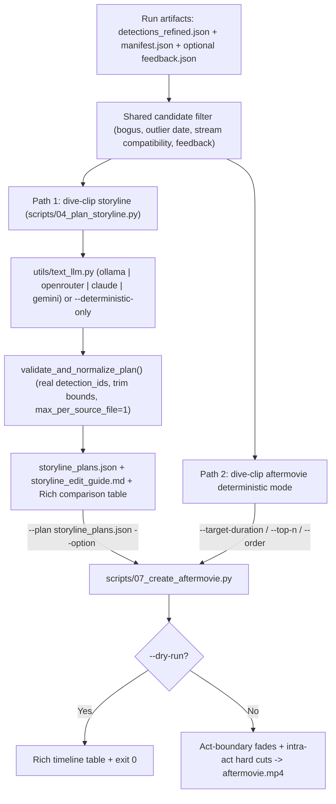

# Architecture Plan: [Issue #85] Multi-option storyline planner, deterministic selection fixes, and plan-driven aftermovie assembly

- **Issue**: [#85](https://github.com/tiwu/dive-clip-tui/issues/85)
- **Status**: Ready for Review
- **Author**: Autonomous Agent / Contributor
- **Date**: 2026-11-20
- **Updated**: 2026-11-21
- **Target Branch**: `feature/issue-85-storyline-planner-and-aftermovie-controls`
- **Related Issue**: [#84](https://github.com/tiwu/dive-clip-tui/issues/84) (GoPro GPMF `STMP` clock & Pass 2 orientation merge guard — recommended first so scan outputs exclude inverted clips upstream)

---

## 1. Problem Statement & Motivation

Currently, creating a highlight aftermovie has two disconnected, rigid paths:

1. **Opaque, unsteerable `dive-clip aftermovie` (`scripts/07_create_aftermovie.py`):**
   - Only accepts `--top-n` (default `10`), with no `--dry-run` preview of what will be rendered, no target runtime or clip pacing controls, and no way to steer narrative structure.
2. **Disconnected legacy `scripts/04_plan_storyline.py`:**
   - Hardcodes `"Madagascar"` and underwater-only prompt instructions, supports only Claude and Gemini, emits non-executable Markdown (`storyline_edit_guide.md`), and is not wired into `dive-clip` CLI or `07_create_aftermovie.py`.
3. **Residual hardcoded `"Madagascar"` metadata (`scripts/03_generate_edl.py`, `config*.yaml`):**
   - `scripts/03_generate_edl.py` hardcodes `"TITLE: MADAGASCAR_AI_MARKERS"` in every exported CMX 3600 EDL regardless of footage, and `config.yaml` (plus preset configs `config.aftermovie.yaml`, `config.social.yaml`, `config.subject.yaml`) default `general.project_name` to `"Madagascar_Dives_2026"`, which gets copied verbatim into every archived `<run_dir>/config.yaml`.

Evaluation against `run-20261119-155336` (111 GoPro 4K clips, 314 detections totaling 33.4 minutes) and prototype aftermovie renders revealed six concrete gaps:

1. **GoPro chapter sorting bug (`utils/selection.py`):** `make_sort_key()` sorts alphabetically by `file_name`. Multi-chapter GoPro files such as `GX020874.MP4` (recorded Sep 15 `04:29` before diving) sort after `GX010897.MP4` (`08:34`), dropping morning boat footage at the end of the film.
2. **Quality-score ceiling hides rare encounters:** `291/314` detections scored `8/10` and `23` scored `9/10`, so `--top-n 10` picked `9/10` `hero_subject` shots (`sand dollar`, `Starfish`, `Giant Clam`) while missing `8/10` highlights (`shark`, `octopus`, `seahorse`, `frogfish`, `lionfish`, `stonefish`, boat departure, ascent/surface moments).
3. **Outlier & noisy detections leak through:** Pre-trip home footage (`GX010772.MP4`, recorded 22 days earlier) and `story_role="none"` / `"no diver visible"` clips remained eligible.
4. **`"unknown"` subject MMR loophole:** `"unknown"` is in `STOPWORDS`, so `calculate_pairwise_similarity()` assigns `j_subj = 0.0` between two `"unknown"` detections, falsely treating `"unknown"` shots as maximally diverse.
5. **Source-file repetition across acts:** Reusing the same video file in both buildup and closing (e.g., `GX010794.MP4` boat splash in Act 1 and boat wake in Act 5) reduces visual variety. Both deterministic selection and LLM storyline proposals need a configurable `max_per_source_file` cap (default `1`).
6. **Distinct preset pacing:** A short `teaser` (`~45–60s`) needs a crisp 1–2 shot hook and rapid-fire `2.0–3.5s` flashes of rare/specialty hero subjects previewing the longer render, whereas `highlight` (`~150s`) and `aftermovie` (`~240s`) follow full 5-act narrative pacing (`4–7s` per shot).

---

## 2. Architecture & Data Flow



---

## 3. Locked Technical Contracts

### 3.1 Machine-Readable Edit Plan Schema (`utils/models.py`)

Add four strict Pydantic v2 models representing multi-option edit proposals and deterministic plans:

- `EditShot`:
  - `detection_id: str`
  - `clip_id: str`
  - `file_name: str`
  - `file_path: str`
  - `creation_time: str = ""`
  - `act: int` (`ge=1`)
  - `act_title: str = ""`
  - `in_time: float` (`ge=0`)
  - `out_time: float` (`gt=in_time`, enforced by `@model_validator`)
  - `duration: float` (`gt=0`)
  - `subject: str = ""`
  - `story_role: str = "hero_subject"`
  - `quality_score: int = 0`
  - `transition_in: Literal["cut", "fade"] = "cut"`
  - `transition_out: Literal["cut", "fade"] = "cut"`
  - `rationale: str = ""`
- `EditAct`:
  - `act_number: int` (`ge=1`)
  - `title: str`
  - `goal: str = ""`
  - `shots: list[EditShot]`
- `EditPlan`:
  - `id: str` (e.g. `"teaser"`, `"highlight"`, `"aftermovie"`, `"deterministic_arc_150s"`)
  - `title: str`
  - `style: str = ""`
  - `preset: str = ""`
  - `target_duration_seconds: int` (`gt=0`)
  - `estimated_duration_seconds: float` (`ge=0`)
  - `clip_count: int` (`ge=0`)
  - `narrative_summary: str = ""`
  - `acts: list[EditAct]`
  - `shots: list[EditShot]` (flattened ordered sequence matching `acts`)
- `StorylineProposalSet`:
  - `schema_version: int = 1`
  - `run_id: str = ""`
  - `provider: str = ""`
  - `model: str = ""`
  - `source_detections: str = ""`
  - `max_per_source_file: int = 1`
  - `proposals: list[EditPlan]`

**Critical `detection_id` lookup invariant:** Merged detections in `detections_refined.json` retain their first constituent window's end time inside `detection_id` (e.g., `clip_09a759e892ce0285_00001.50_00005.00` while `end_time` is `13.0`). Consumers and validators MUST index detections directly by `det.detection_id`, never recomputing `make_detection_id(clip_id, start_time, end_time)`.

### 3.2 Deterministic Selection & Candidate Filtering (`utils/selection.py`)

1. **True Chronological Sorting (`parse_gopro_filename`, `make_chronological_sort_key`):**
   - Parse GoPro naming `^G[XHPA](\d{2})(\d{4})` into `(0, file_num, chapter, file_name)` (falling back to `(1, 0, 0, file_name)` for non-GoPro names).
   - Build sort tuple `(creation_time or "9999", parsed_filename, start_time, end_time, clip_id)` when manifest `clip_meta` is supplied, ensuring `GX020874.MP4` (`2026-09-15T04:29`) sorts before `GX010876.MP4` (`06:03`), and falling back seamlessly to `make_sort_key()` when `creation_time` is absent.
2. **`"unknown"` Similarity Fix in `calculate_pairwise_similarity()`:**
   - When `tokenize_content_words(subj_i)` or `tokenize_content_words(subj_j)` is empty (e.g., `"unknown"` or `"none"`), fall back to `j_desc` for `j_subj` instead of returning `0.0` so unlabeled scenes cannot bypass diversity penalties.
3. **Shared Candidate Filtering (`filter_selection_candidates`):**
   - Exclude `story_role == "none"` and bogus subjects (`""`, `"none"`, `"no diver visible"`, `"no subject"`).
   - Exclude minority stream-spec clips (`(fps, has_audio) != majority_spec`) so `concat_clips` (`-c copy`) remains stream-compatible.
   - Apply `feedback.json` if present: drop `decision == "reject"`, apply `corrected_subject` on `wrong_subject`, and flag `keep` items for a `+0.08` relevance boost.
   - Apply optional `--exclude-file` and `--date-range` (`YYYY-MM-DD:YYYY-MM-DD`).
   - Apply outlier-date guard: compute median recording date across clips with detections and exclude clips outside `outlier_days` (default `7`) with a clear warning unless `allow_outlier_dates=True`.
   - Return `(filtered_candidates, filter_report)` for traceability.
4. **Strict `max_per_source_file` Cap & Duration-Budget Selector (`select_duration_budget_highlights`):**
   - Preserve `select_diverse_highlights(..., top_n=...)` backward compatibility while accepting optional `clip_meta`, `feedback`, and `max_per_source_file`.
   - Add `select_duration_budget_highlights(...)` supporting `target_duration`, `clip_duration_cap`, `max_per_source_file` (default `1`, enforced strictly across the edit), `order: Literal["chronological", "story_arc"]`, centered window trimming (snapped to `0.5s`), role-balanced duration buckets, scoped underwater hero rarity bonus (`1 <= len(tokens) <= 6`, excluding generic descriptors so verbose `generic_highlight` prose subjects are not inflated), and sustained-shot stability adjustment (`+0.03` for `>= 6.0s`, `-0.02` for `hero_subject <= 3.6s`).
   - Outputs an `EditPlan` with act assignments and act-boundary `fade` / intra-act `cut` transitions.

### 3.3 Unified Pluggable Text-LLM Client (`utils/text_llm.py`)

Keep text storyline LLM logic cleanly decoupled from image-based `VLMClient` (`utils/vlm_client.py`):

- **`TextLLMClient` protocol:**
  ```python
  class TextLLMClient(Protocol):
      provider: str
      model: str
      def generate_json(
          self,
          prompt: str,
          system_prompt: str | None = None,
          temperature: float = 0.4,
          max_tokens: int = 4096,
      ) -> dict[str, Any]: ...
  ```
- **Supported backends via `create_text_llm_client(config, provider=None, model=None)`:**
  - `ollama`: Local `POST {host}/api/generate` reusing `resolve_host()` (`utils/ollama_client.py`) and `extract_json_object()` (`utils/vlm_common.py`), `"format": "json"`, `"stream": False`, configurable `num_ctx` / `num_predict` (default generous token budget e.g. `4096` for full edit-plan JSON).
  - `openrouter`: `POST https://openrouter.ai/api/v1/chat/completions` reusing `OPENROUTER_API_KEY`, `RateLimiter`, and retry/backoff helpers from `utils/vlm_client.py` with `response_format: {"type": "json_object"}`.
  - `claude`: Anthropic SDK (`ANTHROPIC_API_KEY`) + `extract_json_object()`.
  - `gemini`: Google GenAI SDK (`GEMINI_API_KEY`) + `extract_json_object()`.
- **Configuration & precedence:**
  - CLI `--provider` and `--model` override `storyline.provider` / `storyline.model` in `config.yaml`, which fall back cleanly to `cloud_storyline` or `ollama` defaults when `storyline:` is omitted.
  - Per-provider default models defined cleanly in `utils/text_llm.py` (`ollama` -> `ollama.model`, `openrouter` -> configurable/openrouter default, `claude` -> `claude-3-5-sonnet-latest`, `gemini` -> `gemini-2.5-flash`).

### 3.4 Multi-Option Storyline Planner (`utils/storyline.py`, `scripts/04_plan_storyline.py`, `dive-clip storyline`)

1. **Domain-Agnostic Catalog & Preset Prompts (`utils/storyline.py`):**
   - Build a compact, token-efficient catalog from filtered detections enriched with manifest `creation_time` and duration, grouped chronologically by date (removing hardcoded `"Madagascar"` / underwater-only assumptions so diving, motorcycle, and generic clips work equally well).
   - Define built-in preset specs:
     - `teaser` (`target_duration=55s`, `shot_duration=2.0–3.5s`): Brief 1–2 shot intro hook -> rapid-fire flashes showcasing rare/specialty hero subjects to tease what is in a full render -> brief punchy outro.
     - `highlight` (`target_duration=150s`, `shot_duration=4.0–7.0s`): Balanced 5-act narrative arc with clean progression across acts.
     - `aftermovie` (`target_duration=240s`, `shot_duration=4.5–9.0s`): Extended trip film covering full breadth of scenes and wildlife/action moments.
   - Support custom durations via `--durations 60,150,240` or preset selection via `--presets teaser,highlight,aftermovie`.
2. **Strict Deterministic Post-Validation (`validate_and_normalize_plan`):**
   - Reject or repair hallucinated model outputs deterministically:
     - Look up every shot by `detection_id` (drop unknown IDs with a warning).
     - Clamp `[in_time, out_time]` strictly inside `[det.start_time, det.end_time]`; drop shots whose trimmed duration falls below `1.5s`.
     - Enforce `max_per_source_file` (default `1`) across the entire plan — keeping the first occurrence and dropping duplicate source files with a logged warning.
     - Stamp act-boundary transitions (`transition_in="fade"` at shot 0 or act change, `"cut"` inside an act; `transition_out="fade"` at final shot or before act change, `"cut"` inside an act).
     - Recompute `estimated_duration_seconds` and `clip_count` from validated shots.
   - Also support `--deterministic-only` so users can generate `storyline_plans.json` offline without calling any LLM.
3. **CLI & Artifacts (`scripts/04_plan_storyline.py` + `dive-clip storyline`):**
   - Flags: `--config`, `--run`, `--input`, `--output`, `--provider`, `--model`, `--presets`, `--durations`, `--narrative` / `--prompt`, `--max-per-source-file` (default `1`), `--date-range`, `--exclude-file` (repeatable), `--allow-outlier-dates`, `--deterministic-only`, `--debug`, `--trace`, `--log-file`.
   - Writes `<run_dir>/storyline_plans.json` AND renders `<run_dir>/storyline_edit_guide.md` deterministically from the validated `StorylineProposalSet` (archived via `utils/run_archive.py`).
   - Prints a Rich side-by-side summary table of all proposed options plus exact `dive-clip aftermovie --plan ... --option <id>` commands.
   - Retain backward-compatible helper functions (`build_prompt`, `call_claude`, `call_gemini`) or keep existing tests passing alongside new multi-option tests.

### 3.5 Transparent, Plan-Driven Aftermovie Renderer (`scripts/07_create_aftermovie.py`, `scripts/dive_clip.py`)

1. **New flags on both `07_create_aftermovie.py` and `dive-clip aftermovie`:**
   - `--run <id|path>` (resolve detections, manifest, feedback, and default output inside that run folder)
   - `--plan <storyline_plans.json>` + `--option <id|all>` (renders the chosen option or loops over all options to `aftermovie_<option_id>.mp4` inside the target folder)
   - `--dry-run` / `--preview` (prints Rich table of selected shots — Act, File, Recorded Time, Trim Window, Duration, Quality, Role, Subject, Transitions — plus total runtime and filter summary, then exits `0` without calling FFmpeg)
   - `--target-duration <seconds>` & `--max-clip-duration <seconds>` (deterministic duration-budget selection + centered trimming)
   - `--order chronological|story_arc` (default `chronological` or configurable)
   - `--max-per-source-file <int>` (default `1`)
   - `--date-range`, `--exclude-file` (repeatable), `--allow-outlier-dates`
   - Keep `--top-n` working smoothly when `--plan` and `--target-duration` are not passed.
2. **Act-boundary transitions during rendering:**
   - In `--plan` mode (and deterministic `--order story_arc` mode), render each shot using its `in_time`..`out_time` and explicit `transition_in == "fade"` / `transition_out == "fade"` flags (act boundaries fade to/from black; shots within the same act hard-cut cleanly).
   - Keep `selection_trace.json` populated in deterministic mode and update `utils/run_archive.py` (`archive_run_artifacts`) to archive `storyline_plans.json` and `storyline_edit_guide.md`.
3. **Configuration & Documentation:**
   - Add documented `storyline:` section and new `selection:` / `aftermovie:` defaults (`max_per_source_file: 1`, `outlier_days: 7`) to `config.yaml`.
   - Update `README.md`, `AGENTS.md`, `docs/roadmap/roadmap.md`, and `CHANGELOG.md`.

### 3.6 Remove Residual Hardcoded "Madagascar" Metadata (`scripts/03_generate_edl.py`, `config*.yaml`, `README.md`)

- **`scripts/03_generate_edl.py`:**
  - Add `DEFAULT_EDL_TITLE = "DIVE_CLIP_AI_MARKERS"` and `format_edl_title(project_name: str | None) -> str` that sanitizes a project name to CMX 3600-safe uppercase ASCII (replace non-`[A-Za-z0-9]` runs with `_`, strip leading/trailing `_`, uppercase, append `_AI_MARKERS` unless already ending with `_AI_MARKERS`; return `DEFAULT_EDL_TITLE` if empty).
  - Update `generate_edl(detections: DetectionsRefined, output_path: Path, title: str | None = None) -> None` to emit `f"TITLE: {resolved_title}"` (defaulting to `DEFAULT_EDL_TITLE` when `title` is `None`/blank, and sanitizing/stripping newlines so invalid CMX headers cannot be injected).
  - In `main()`, resolve the EDL title with precedence: sibling `manifest.json` (or `manifest_raw.json`) `project_name` next to `detections_refined.json` if present and non-empty -> `config.get("general", {}).get("project_name")` if non-empty -> formatted via `format_edl_title()` -> fallback `DEFAULT_EDL_TITLE`.
- **Config files & documentation:**
  - Replace `project_name: "Madagascar_Dives_2026"` (and the `_Social` / `_Subjects` variants) with neutral `project_name: ""` (with an inline comment explaining it is an optional fallback label for EDL titles while folder ingest uses the folder name) across all tracked config files: `config.yaml`, `config.aftermovie.yaml`, `config.social.yaml`, and `config.subject.yaml`.
  - Update the `project_name` row in `README.md` to reflect default `""` and its actual usage (optional fallback label for EDL title; folder ingest uses the input folder name and Resolve uses the open project name).

---

## 4. Requirements & Acceptance Criteria

- [x] **Schemas (`utils/models.py`)**: `EditShot`, `EditAct`, `EditPlan`, and `StorylineProposalSet` validate shot bounds (`out_time > in_time`) and round-trip cleanly to/from JSON.
- [x] **Deterministic selection fixes (`utils/selection.py`)**:
  - True chronological ordering sorts by `creation_time` and GoPro `(file_num, chapter)` before filename.
  - `"unknown"` subjects fall back to description Jaccard instead of zero similarity penalty.
  - Bogus subjects, `story_role="none"`, stream-mismatched files, outlier dates (`> 7` days by default), and `feedback.json` (`reject`/`wrong_subject`/`keep`) are handled deterministically.
  - `max_per_source_file` (default `1`) prevents repeating source videos across acts, and `select_duration_budget_highlights()` supports `--target-duration`, `--max-clip-duration`, and `--order`.
- [x] **Pluggable text-LLM client (`utils/text_llm.py`)**: Supports `ollama`, `openrouter`, `claude`, and `gemini`, configurable in `config.yaml` and overridable via `--provider` / `--model`.
- [x] **Multi-option storyline planner (`utils/storyline.py`, `scripts/04_plan_storyline.py`, `dive-clip storyline`)**:
  - Produces multiple length/pacing proposals (`teaser`, `highlight`, `aftermovie`, or custom `--durations`), with `teaser` tuned for rapid-fire rare hero flashes plus brief intro/outro.
  - Validates every shot against real `detection_id`s, clamps trim bounds, enforces `max_per_source_file`, writes `storyline_plans.json` and `storyline_edit_guide.md`, and works offline with `--deterministic-only`.
- [x] **Plan-driven & previewable aftermovie (`scripts/07_create_aftermovie.py`, `scripts/dive_clip.py`)**:
  - Supports `--run`, `--plan`, `--option <id|all>`, `--dry-run` / `--preview`, `--target-duration`, `--max-clip-duration`, `--order`, `--max-per-source-file`, `--date-range`, `--exclude-file`, `--allow-outlier-dates` while preserving `--top-n`.
  - Applies act-boundary dip-to-black fades and intra-act hard cuts when rendering plans.
- [x] **Remove hardcoded `"Madagascar"` defaults (`scripts/03_generate_edl.py`, `config*.yaml`, `README.md`)**:
  - `generate_edl()` defaults to `TITLE: DIVE_CLIP_AI_MARKERS` (no hardcoded `MADAGASCAR_AI_MARKERS`), and `main()` derives a sanitized `<PROJECT>_AI_MARKERS` title from sibling `manifest.json` `project_name` or `config.general.project_name` when set.
  - Tracked `config.yaml`, `config.aftermovie.yaml`, `config.social.yaml`, `config.subject.yaml`, and `README.md` no longer default `project_name` to `"Madagascar_Dives_2026"`.
- [x] **Tests & documentation**: Comprehensive unit tests pass across all new/changed modules; `config*.yaml`, `README.md`, `AGENTS.md`, `docs/roadmap/roadmap.md`, and `CHANGELOG.md` are updated.

---

## 5. Change Log and Release Impact

- **Change category**: `Added` / `Fixed`
- **Proposed SemVer impact**: `semver:minor`
- **Draft changelog entry**:
  - `Added`: Add multi-option storyline planning (`dive-clip storyline`) with swappable `ollama`, `openrouter`, `claude`, and `gemini` backends, machine-readable `storyline_plans.json`, and plan-driven aftermovie controls (`--plan`, `--option`, `--dry-run`, `--target-duration`, `--max-per-source-file`, `--order`) alongside chronological `creation_time` sorting and outlier/noise selection fixes.
  - `Fixed`: Remove hardcoded `"Madagascar"` defaults from storyline prompts (`scripts/04_plan_storyline.py`), CMX 3600 EDL titles (`scripts/03_generate_edl.py`), and tracked `config*.yaml` files.

---

## 6. Test-Driven Development (TDD) Plan

1. **Red (Tests First)**:
   - `tests/test_models.py`: test `EditShot` (`out_time <= in_time` validation error), `EditPlan`, and `StorylineProposalSet` JSON round-trip.
   - `tests/test_selection.py`:
     - Test GoPro chapter sorting (`GX020874.MP4` at `04:29` before `GX010876.MP4` at `06:03`).
     - Test `"unknown"` subject similarity falls back to description Jaccard instead of `0.0`.
     - Test `filter_selection_candidates()` dropping `story_role="none"`, `"no diver visible"`, stream mismatches, outlier dates, and `feedback.json` rejects while boosting `keep`.
     - Test `select_duration_budget_highlights()` enforces `max_per_source_file=1`, trims long windows around midpoint, applies scoped underwater rarity bonus without boosting verbose generic prose, and arranges 5 acts.
   - `tests/test_text_llm.py`:
     - Test `create_text_llm_client()` provider selection and CLI overrides for `ollama`, `openrouter`, `claude`, and `gemini` with mocked transport/SDKs, including JSON extraction from fenced/thinking output and missing API key errors.
   - `tests/test_plan_storyline.py`:
     - Test multi-option generation (`teaser`, `highlight`, `aftermovie`), `--deterministic-only`, and `validate_and_normalize_plan()` rejecting unknown `detection_id`, clamping out-of-range trim bounds, dropping sub-`1.5s` fragments, enforcing `max_per_source_file`, and emitting both `storyline_plans.json` and `storyline_edit_guide.md`.
   - `tests/test_aftermovie.py` & `tests/test_dive_clip.py`:
     - Test `--dry-run` renders Rich preview table and exits `0` without calling FFmpeg.
     - Test `--plan` + `--option` uses `in_time`/`out_time` and act-boundary fades (`fade_in`/`fade_out` only at act transitions).
     - Test `--option all` renders separate `aftermovie_<option_id>.mp4` outputs.
     - Test `dive-clip storyline` and updated `dive-clip aftermovie` argument forwarding.
   - `tests/test_generate_edl.py`:
     - Update default EDL title assertions from `TITLE: MADAGASCAR_AI_MARKERS` to `TITLE: DIVE_CLIP_AI_MARKERS`.
     - Test `format_edl_title()` sanitization/suffix behavior, explicit `title` override on `generate_edl()`, and `main()` deriving the EDL title from sibling `manifest.json` `project_name` or `config.general.project_name` fallback.
2. **Green (Implementation)**:
   - Update `utils/models.py`, `utils/selection.py`, `utils/run_archive.py`.
   - Add `utils/text_llm.py` and `utils/storyline.py`.
   - Update `scripts/03_generate_edl.py`, `scripts/04_plan_storyline.py`, `scripts/07_create_aftermovie.py`, `scripts/dive_clip.py`.
   - Update `config.yaml`, `config.aftermovie.yaml`, `config.social.yaml`, `config.subject.yaml`, `README.md`, `AGENTS.md`, `docs/roadmap/roadmap.md`, `CHANGELOG.md`.
3. **Refactor & Quality**:
   - Run focused test files, then full `uv run python -m pytest`.
   - Run `uv run ruff check` and `uv run ruff format --check` across all changed files.

---

## 7. Verification & Rollout Checklist

- [x] Tests pass: `uv run python -m pytest`
- [x] Changed Python files pass Ruff lint and formatting checks
- [x] Documentation updated (`config*.yaml`, `README.md`, `AGENTS.md`, `docs/roadmap/roadmap.md`, `CHANGELOG.md`)
- [ ] PR labeled with `semver:minor`
- [ ] PR submitted with `Closes #85` and plan linked
