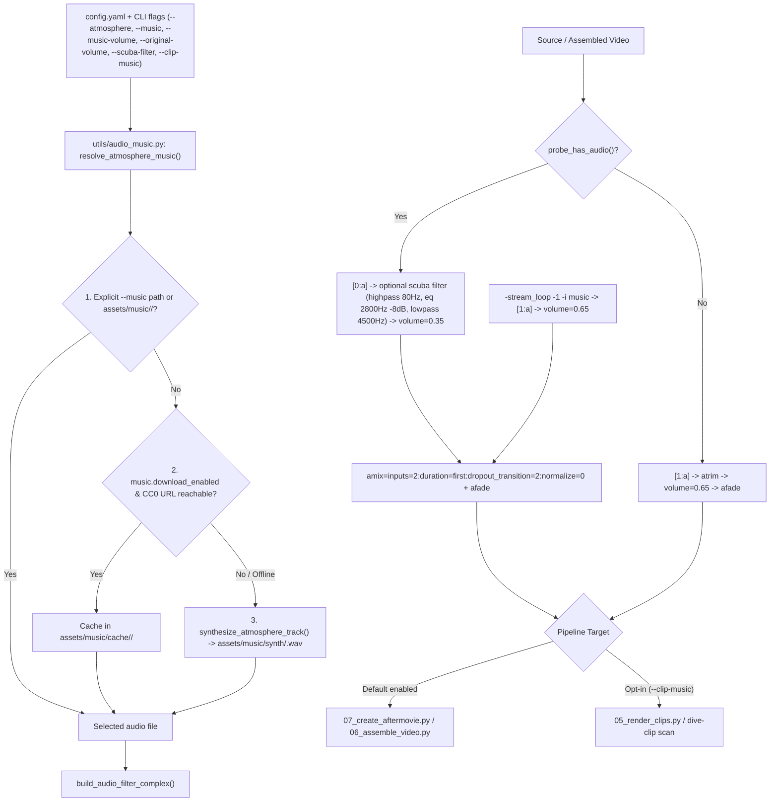

# Architecture Plan: [Issue #89] Selectable copyright-free music atmospheres and scuba breathing audio mix

- **Issue**: [#89](https://github.com/tiwu/dive-clip-tui/issues/89)
- **Status**: Completed
- **Author**: Autonomous Agent / Contributor
- **Date**: 2026-11-21
- **Target Branch**: `feature/issue-89-background-music-atmospheres-and-scuba-audio-mix`

---

## 1. Problem Statement & Motivation

Action-camera dive footage frequently contains loud, harsh scuba regulator breathing, exhaust bubbles, and hydrophone rumble that overpower playback. Users want to retain the underwater ambience in the background at a comfortable `30-40%` level (default `35%`)—ideally softened against harsh regulator hiss—while mixing in selectable, copyright-free background music across distinct atmospheres (`ocean_ambient`, `chill`, `cinematic`, `upbeat`).

Currently, the repository has three gaps:

1. **`scripts/07_create_aftermovie.py` (`add_background_music`)**:
   - Requires a manually supplied `--music <file>` path with no built-in royalty-free tracks or atmosphere selection.
   - Leaves original clip audio unattenuated (relying on default `amix` behavior rather than explicit `original_volume` and `music_volume` scaling).
   - Lacks scuba regulator-hiss filtering and smooth audio fade-in/fade-out transitions.
   - Fails if a clip has no audio stream (`[0:a]` missing).
2. **`scripts/06_assemble_video.py` (`dive-clip assemble`)**:
   - Concatenates clips with 100% raw camera audio and offers no background music or audio mixing options.
3. **`scripts/05_render_clips.py` (`render-clips` / `dive-clip scan`)**:
   - Provides no opt-in `--clip-music` capability to apply background music and scuba audio attenuation to standalone highlight clips rendered into `highlights/`.

---

## 2. Architecture & Data Flow



---

## 3. Locked Technical Contracts

### 3.1 Shared Music & Scuba Audio Mixing Module (`utils/audio_music.py`)

1. **Atmosphere Definitions & Aliases (`ATMOSPHERE_ALIASES`)**:
   - `"ocean_ambient"` (alias `"ambient"`): warm underwater drone / pad (`C2-G2-D3-E3-B3` slow harmonic swell, low-passed warm pad).
   - `"chill"` (alias `"calm"`): soft melodic chord progression (`Am7 -> Dm9 -> G13 -> Cmaj7` gentle warm keys/pad).
   - `"cinematic"`: deep atmospheric fifths/octaves swell with slow dynamic cresting.
   - `"upbeat"` (alias `"action"`): energetic rhythmic pulse (`116 BPM` soft synth pulse + chord bed, well-suited for fast dive or motorcycle clips).
   - `"none"`: disables background music track.

2. **`MusicConfig` Dataclass & Resolver (`resolve_music_config(config, args)`)**:
   - `atmosphere: str = "ocean_ambient"`
   - `music_path: Path | None = None`
   - `original_volume: float = 0.35`
   - `music_volume: float = 0.65`
   - `scuba_filter: bool = True`
   - `audio_fade_duration: float = 1.0`
   - `clip_music: bool = False`
   - `download_enabled: bool = True`
   - `cache_dir: Path = Path("assets/music")`
   - `atmosphere_urls: dict[str, list[str]]` (curated CC0 URLs, configurable in `config.yaml`)

3. **Three-Tier Copyright-Free Music Resolution (`resolve_atmosphere_music`)**:
   ```python
   def resolve_atmosphere_music(
       atmosphere: str,
       *,
       music_path: Path | None = None,
       duration_seconds: float = 32.0,
       cache_dir: Path = Path("assets/music"),
       download_enabled: bool = True,
       atmosphere_urls: dict[str, list[str]] | None = None,
   ) -> Path | None: ...
   ```
   Resolution order:
   1. If `music_path` is provided, validate that it exists and return it.
   2. If `atmosphere == "none"`, return `None`.
   3. Normalize atmosphere alias (`ambient` -> `ocean_ambient`, `calm` -> `chill`, `action` -> `upbeat`).
   4. Search for existing local audio files (`.mp3`, `.ogg`, `.wav`, `.flac`, `.m4a`) in `<cache_dir>/<atmosphere>/` or `<cache_dir>/<atmosphere>.<ext>` (as well as previously cached downloads in `<cache_dir>/cache/<atmosphere>/`).
   5. If `download_enabled` is `True`, attempt to download a curated CC0 / Public Domain track from `atmosphere_urls` into `<cache_dir>/cache/<atmosphere>/` via `urllib.request` (`timeout=15`), verifying non-empty audio content.
   6. Fall back seamlessly to `synthesize_atmosphere_track(atmosphere, output_path=<cache_dir>/synth/<atmosphere>.wav, duration_seconds=max(32.0, duration_seconds))` using pure Python (`wave`, `math`, `struct`) so playback works 100% offline with zero external dependencies or copyright concerns.

4. **Audio Stream Probing & Filter Graph (`probe_has_audio`, `build_audio_filter_complex`)**:
   - `probe_has_audio(video_path: Path) -> bool`:
     - Uses `ffprobe -v error -select_streams a -show_entries stream=codec_type -of csv=p=0` to detect whether the video contains an audio stream.
   - `build_audio_filter_complex(*, has_source_audio: bool, has_music: bool, original_volume: float = 0.35, music_volume: float = 0.65, scuba_filter: bool = True, fade_duration: float = 1.0, video_duration: float | None = None) -> tuple[str | None, str]`:
     - Scuba regulator filter chain on `[0:a]` when `scuba_filter=True`:
       `highpass=f=80,equalizer=f=2800:t=q:w=1.2:g=-8,lowpass=f=4500`
     - Volume scaling on `[0:a]`: `volume={original_volume:.3f}`
     - Music stream `[1:a]`: looped cleanly at input via `-stream_loop -1 -i <music>`, scaled with `volume={music_volume:g}` (plus `atrim=0:{video_duration:g},asetpts=PTS-STARTPTS` on silent source clips so `-shortest` terminates deterministically).
     - Mix: `[orig][music]amix=inputs=2:duration=first:dropout_transition=2:normalize=0` (with fallback to standard `amix=inputs=2:duration=first` if an older FFmpeg build rejects `normalize=0`)
     - When `has_source_audio` is `False` and `has_music` is `True`, maps `[1:a]` with volume and fade directly to `[aout]` trimmed to video duration (`-shortest`).

---

### 3.2 Aftermovie & Assemble Integration (`scripts/07_create_aftermovie.py`, `scripts/06_assemble_video.py`, `scripts/dive_clip.py`)

1. **Updated `add_background_music()` in `scripts/07_create_aftermovie.py`**:
   - Accepts `original_volume: float = 0.35`, `scuba_filter: bool = True`, `fade_duration: float = 1.0` alongside `music_volume: float = 0.65` (preserving backward compatibility for existing callers/tests).
   - Handles silent/no-audio source videos gracefully via `probe_has_audio()`.
   - Resolves `atmosphere` music via `resolve_atmosphere_music()` when no explicit `--music` file is supplied.
2. **CLI Flags across `07_create_aftermovie.py`, `06_assemble_video.py`, `dive-clip aftermovie`, `dive-clip assemble`, and `dive-clip scan`**:
   - `--atmosphere {ocean_ambient,ambient,chill,calm,cinematic,upbeat,action,none}`
   - `--music <path>`
   - `--music-volume <float>` (default `0.65` in config)
   - `--original-volume <float>` (default `0.35` in config)
   - `--scuba-filter` / `--no-scuba-filter`
3. **`scripts/06_assemble_video.py`**:
   - After `concat_clips()` succeeds, if an atmosphere (`!= "none"`), explicit `--music`, `scuba_filter`, or `original_volume != 1.0` is active, applies the audio mix pass before finalizing the output MP4.

---

### 3.3 Opt-In Individual Clip Music (`scripts/05_render_clips.py`, `scripts/dive_clip.py`)

1. Add `--clip-music`, `--atmosphere`, `--music`, `--music-volume`, `--original-volume`, and `--scuba-filter` / `--no-scuba-filter` to `scripts/05_render_clips.py`, and `--clip-music` / `--atmosphere` (plus audio mix options) to `dive-clip scan`.
2. Default `clip_music` is `False` so standalone clips in `highlights/` retain raw camera audio unless `--clip-music` (or `music.clip_music: true` in `config.yaml`) is enabled.
3. When `clip_music` is enabled, `render_clip()` mixes the resolved atmosphere track and attenuates/filters original scuba breathing audio (`35%` original, `65%` music) before atomic output publish.

---

### 3.4 Configuration & Documentation (`config.yaml`, `README.md`, `AGENTS.md`)

1. Add a `music:` configuration block to `config.yaml`:
   ```yaml
   music:
     atmosphere: "ocean_ambient"     # ocean_ambient, chill, cinematic, upbeat, or none
     music_volume: 0.65              # Background music level in final mix
     original_audio_volume: 0.35     # Original camera/scuba audio level (30-40% target)
     scuba_filter: true              # Soft high-cut & regulator-hiss EQ on original audio
     audio_fade_duration: 1.0        # Audio fade-in/out duration (seconds)
     clip_music: false               # Opt-in music mixing for individual clips in highlights/
     download_enabled: true          # Allow on-demand download & local caching of CC0 tracks
     cache_dir: "assets/music"       # Local music library and cache folder
   ```
2. Update `aftermovie:` defaults (`music_volume: 0.65`, `original_audio_volume: 0.35`, `atmosphere: "ocean_ambient"`, `scuba_filter: true`) in `config.yaml` and update `README.md` and `AGENTS.md`.

---

## 4. Requirements & Acceptance Criteria

- [x] **Atmosphere selection**: Supports `ocean_ambient` (`ambient`), `chill` (`calm`), `cinematic`, `upbeat` (`action`), and `none`, configurable in `config.yaml` and via `--atmosphere`.
- [x] **Three-tier copyright-free music resolution**: Resolves explicit `--music` / local `assets/music/<atmosphere>/` files first, optional on-demand CC0 download & cache second, and offline procedural multi-voice stereo WAV synthesis third.
- [x] **Scuba breathing mix & hiss filter**: Keeps original audio at configurable `original_volume` (default `0.35`, i.e. 35%) with optional regulator-hiss EQ filter (`highpass=f=80,equalizer=f=2800:t=q:w=1.2:g=-8,lowpass=f=4500`) and smooth audio fades, mixed cleanly with `music_volume` (default `0.65`).
- [x] **Silent video resilience**: Handles clips without an audio track cleanly without FFmpeg filter errors.
- [x] **Default vs. opt-in scope**: Enabled by default in `dive-clip aftermovie` (`07_create_aftermovie.py`) and `dive-clip assemble` (`06_assemble_video.py`); opt-in via `--clip-music` (or `music.clip_music: true`) in `05_render_clips.py` and `dive-clip scan`.
- [x] **Automated tests**: Unit tests cover all new functions, CLI flags, and edge cases.
- [x] **Documentation**: `config.yaml`, `README.md`, `AGENTS.md`, and `CHANGELOG.md` updated.

---

## 5. Change Log and Release Impact

- **Change category**: `Added`
- **Proposed SemVer impact**: `semver:minor`
- **Draft changelog entry**:
  - `Added`: Add selectable copyright-free background music atmospheres (`ocean_ambient`, `chill`, `cinematic`, `upbeat`, `none`) with on-demand CC0 track caching and offline procedural audio synthesis, plus scuba breathing audio attenuation (`35%` original audio, `65%` music) and regulator-hiss filtering across `aftermovie`, `assemble`, and opt-in `render-clips` (`--clip-music`).

---

## 6. Test-Driven Development (TDD) Plan

1. **Red (Tests First)**:
   - `tests/test_audio_music.py`:
     - Atmosphere alias normalization (`ambient` -> `ocean_ambient`, `calm` -> `chill`, `action` -> `upbeat`, `none`).
     - Local file lookup in `assets/music/<atmosphere>/` and `<cache_dir>/<atmosphere>.<ext>`.
     - On-demand CC0 download caching and offline fallback to procedural WAV synthesis on network failure or `download_enabled=False`.
     - Valid RIFF WAV header, stereo channels, and target duration across all 4 atmospheres (`ocean_ambient`, `chill`, `cinematic`, `upbeat`).
     - `build_audio_filter_complex()` filter strings with/without `scuba_filter`, with/without source audio stream (`probe_has_audio()`), and with audio fade-in/out.
   - `tests/test_aftermovie.py`:
     - `add_background_music()` with `original_volume=0.35`, `music_volume=0.65`, `scuba_filter=True`, `--atmosphere` CLI flag, and silent/no-audio video fallback.
   - `tests/test_assemble_video.py`:
     - `06_assemble_video.py` applying background music and original audio attenuation by default and bypassing when `--atmosphere none`.
   - `tests/test_render_clips.py`:
     - `05_render_clips.py` preserving raw audio by default vs mixing music and scuba attenuation when `--clip-music` is passed.
   - `tests/test_dive_clip.py`:
     - CLI flag forwarding (`--atmosphere`, `--music`, `--music-volume`, `--original-volume`, `--scuba-filter`, `--no-scuba-filter`, `--clip-music`) across `scan`, `assemble`, and `aftermovie`.
2. **Green (Implementation)**:
   - Create `utils/audio_music.py`.
   - Update `scripts/07_create_aftermovie.py`, `scripts/06_assemble_video.py`, `scripts/05_render_clips.py`, `scripts/dive_clip.py`.
   - Update `config.yaml`, `README.md`, `AGENTS.md`, `CHANGELOG.md`.
3. **Refactor & Quality**:
   - Run focused test files, then full `uv run python -m pytest`.
   - Run `uv run ruff check` and `uv run ruff format --check` on changed Python files.

---

## 7. Verification & Rollout Checklist

- [x] Tests pass: `uv run python -m pytest`
- [x] Changed Python files pass Ruff lint and formatting checks
- [x] `CHANGELOG.md` updated under `[Unreleased]`
- [ ] PR has no conflicting SemVer labels (unlabeled defaults to minor)
- [ ] PR submitted with `Closes #89` and plan linked
